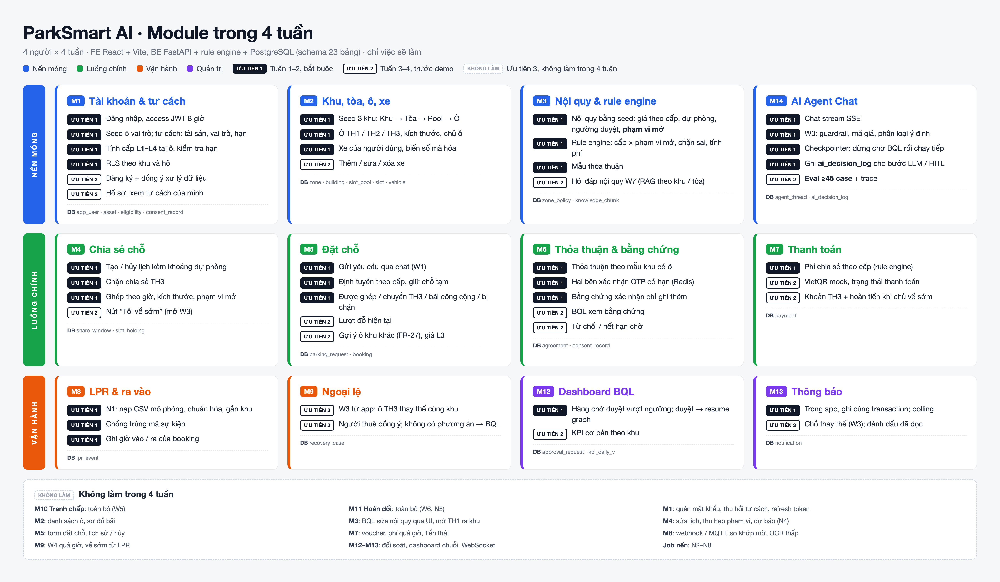

# Backlog — Module (FE / BE)

> **File này trả lời:** mỗi module làm gì trong 4 tuần, dùng bảng DB nào, code ở đâu.
> Liên quan: [README](README.md) (lịch, mục không làm) · [Workflow Agent](02-agent-workflows.md) · [Workflow nền](03-background-workflows.md) · [Data model](../../03-design/01-data-model.md)

Mỗi module gồm **FE** (React + Vite SPA) và **BE** (FastAPI, thư mục dưới `server/src/app/` theo
[ADR-0010](../../07-adr/ADR-0010-backend-modules-agent-workflows-jobs.md)). Chỉ liệt kê việc Ưu tiên 1 và 2;
những gì không làm: [README §5](README.md#5-không-làm-trong-4-tuần-ưu-tiên-3).

## 1. Nền móng

| Module | Ưu tiên 1 (tuần 1–2) | Ưu tiên 2 (tuần 3–4) | Bảng DB | BE |
|--------|----------------------|----------------------|---------|----|
| **M1** Tài khoản & tư cách | Đăng nhập / đăng xuất (access JWT 8 giờ, [ADR-0011](../../07-adr/ADR-0011-mvp-simplifications.md)); seed tài khoản 5 vai trò; tư cách *(tài sản, vai trò, hạn)*; tính cấp L1–L4 tại ô, kiểm tra hạn; RLS theo khu và hộ | Đăng ký kèm đồng ý xử lý dữ liệu; xem hồ sơ và tư cách của mình | `app_user`, `asset`, `eligibility`, `consent_record` | `identity/`, `eligibility/` |
| **M2** Khu, tòa, ô, xe | Seed 3 khu: Khu → Tòa → Pool → Ô (TH1/TH2/TH3, kích thước, chủ ô); xe của người dùng, biển số mã hóa | Thêm / sửa / xóa xe | `zone`, `building`, `slot_pool`, `slot`, `vehicle` | `facility/` |
| **M3** Nội quy & rule engine | Nội quy bằng seed: giá theo cấp, dự phòng, ngưỡng duyệt, phạm vi mở từng pool, mẫu thỏa thuận; rule engine tất định: cấp × phạm vi mở, chặn sai tư cách, tính phí | Hỏi đáp nội quy W7 (RAG lọc theo khu / tòa) | `zone_policy`, `knowledge_chunk` | `policy/`, `knowledge/` |
| **M14** AI Agent Chat | Chat stream SSE; W0 (guardrail, mã giả, phân loại ý định); checkpointer dừng chờ BQL rồi chạy tiếp; ghi `ai_decision_log` cho mọi bước LLM / HITL | Trích dẫn nguồn (W7); **eval ≥45 case + trace** | `agent_thread`, `ai_decision_log` | `agent/` |

## 2. Luồng chính

| Module | Ưu tiên 1 | Ưu tiên 2 | Bảng DB | BE |
|--------|-----------|-----------|---------|----|
| **M4** Chia sẻ chỗ | Tạo / hủy lịch chia sẻ kèm khoảng dự phòng; chặn chia sẻ TH3; ghép theo giờ, kích thước, phạm vi mở | Nút "Tôi về sớm" (mở W3) | `share_window`, `slot_holding` | `sharing/` |
| **M5** Đặt chỗ | Gửi yêu cầu qua chat (W1); định tuyến theo cấp, giữ chỗ tạm; kết quả: được ghép / chuyển TH3 / bãi công cộng / bị chặn kèm lý do | Lượt đỗ hiện tại; gợi ý ô khu khác đủ điều kiện (FR-27, giá L3) | `parking_request`, `booking` | `booking/` |
| **M6** Thỏa thuận & bằng chứng | Sinh thỏa thuận theo mẫu khu có ô; hai bên xác nhận OTP có hạn (OTP trong Redis); lưu bằng chứng xác nhận chỉ ghi thêm | BQL xem bằng chứng xác nhận; thỏa thuận bị từ chối / hết hạn chờ | `agreement`, `consent_record` | `ledger/` |
| **M7** Thanh toán | Tính phí chia sẻ theo cấp (rule engine, ghi trong thỏa thuận) | VietQR mock và trạng thái thanh toán; khoản TH3 và hoàn tiền khi chủ về sớm (D-09) | `payment` | `payment/` |

## 3. Vận hành và quản trị

| Module | Ưu tiên 1 | Ưu tiên 2 | Bảng DB | BE |
|--------|-----------|-----------|---------|----|
| **M8** LPR & ra vào | N1: nạp CSV mô phỏng, chuẩn hóa, chống trùng mã sự kiện, gắn khu; cập nhật `booking.checked_in_at / checked_out_at` | — | `lpr_event` | `access/` |
| **M9** Ngoại lệ | — | W3 từ app: cấp ô TH3 thay thế cùng khu, người thuê đồng ý, BQL xử lý khi không có phương án | `recovery_case` | trong `agent/` (W3) + `booking/` |
| **M12** Dashboard BQL | Hàng chờ duyệt giao dịch vượt ngưỡng theo khu; duyệt / từ chối → resume graph | KPI cơ bản theo khu: yêu cầu, ghép, chuyển hướng, bị chặn | `approval_request`, view `kpi_daily_v` | `approval/`, `reporting/` |
| **M13** Thông báo | Thông báo trong app (kết quả ghép, chờ xác nhận, chờ duyệt), ghi cùng transaction; client polling | Thông báo chỗ thay thế (W3); đánh dấu đã đọc | `notification` | `notification/` |

**M10 Tranh chấp** và **M11 Hoán đổi**: không làm trong 4 tuần (không có bảng trong schema MVP).

## 4. Màn hình theo mức

| Mức | Cư dân / người thuê | BQL khu |
|-----|---------------------|---------|
| Ưu tiên 1 | Đăng nhập, chat, chia sẻ chỗ, kết quả ghép, thỏa thuận + OTP, thông báo | Hàng chờ duyệt (HITL) |
| Ưu tiên 2 | Thanh toán VietQR mock, đăng ký, xe, lượt đỗ hiện tại, "Tôi về sớm", hỏi đáp nội quy | Bằng chứng xác nhận, KPI, ca chủ về sớm |

Wireframe: [ux/wireframes](../ux/wireframes/README.md). Wireframe của tính năng Ưu tiên 3 giữ lại làm thiết kế, không code.
