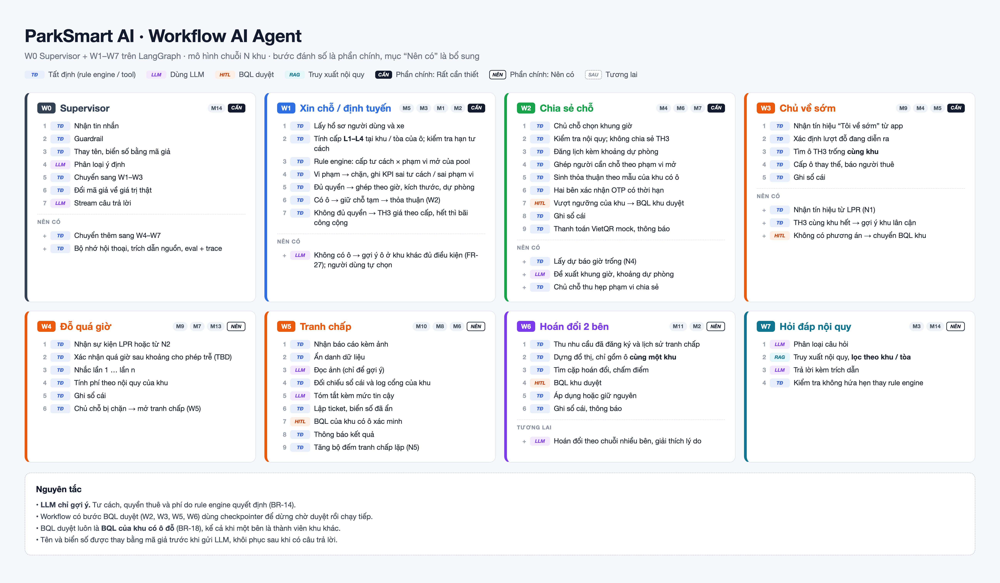

# Backlog — Workflow AI Agent

> **File này trả lời:** mỗi workflow Agent (W0–W7) làm gì, gồm những bước nào, và phần nào thuộc ưu tiên nào trong 4 tuần.
> Liên quan: [README](README.md) · [Module](01-modules.md) · [Workflow nền](03-background-workflows.md) · [PRD §5 quy tắc nghiệp vụ](../02-prd.md#5-quy-tắc-nghiệp-vụ)
> Ảnh: [ParkSmartAI-agent-workflows.png](../../images/ParkSmartAI-agent-workflows.png) (W0 Supervisor + W1–W7, LangGraph; vẽ lại 2026-11-18; chưa cập nhật theo phân bổ ưu tiên mới).

**Loại bước:** `[TĐ]` tất định (rule engine / tool) · `[LLM]` dùng LLM · `[HITL]` BQL duyệt · `[RAG]` truy xuất nội quy.

**Nguyên tắc:**
- LLM chỉ gợi ý. Tư cách, quyền thuê và phí do rule engine quyết định (BR-14).
- W2, W3, W5, W6 có bước BQL duyệt nên cần checkpointer để dừng chờ duyệt rồi chạy tiếp.
- BQL duyệt luôn là **BQL của khu có ô đỗ** (BR-18).

## 1. Tóm tắt theo mức ưu tiên

| Workflow | Phần việc | Ưu tiên 1 | Ưu tiên 2 | Ưu tiên 3 |
|---|---|:---:|:---:|:---:|
| **W0 Supervisor** | Chuỗi bước chính: guardrail → mã giả → `[LLM]` phân loại ý định → chuyển workflow → `[LLM]` stream | ● |  |  |
|  | Chuyển sang W1, W2 | ● |  |  |
|  | Chuyển sang W3, W7 |  | ● |  |
|  | Trích dẫn nguồn; eval ≥45 case + trace |  | ● |  |
|  | Chuyển sang W4–W6 |  |  | ● |
|  | Bộ nhớ hội thoại; giọng nói; đa ngôn ngữ |  |  | ● |
| **W1 Xin chỗ / định tuyến** | Tính cấp L1–L4 tại ô, kiểm tra hạn | ● |  |  |
|  | Rule engine cấp × phạm vi mở; vi phạm → chặn, ghi KPI | ● |  |  |
|  | Ghép theo giờ, kích thước, dự phòng; giữ chỗ tạm | ● |  |  |
|  | Không đủ quyền → TH3 theo giá cấp / bãi công cộng | ● |  |  |
|  | `[LLM]` gợi ý ô ở khu khác đủ điều kiện (FR-27); người dùng tự chọn |  | ● |  |
|  | Đặt chỗ định kỳ ở khu khác |  |  | ● |
| **W2 Chia sẻ chỗ** | Chọn khung giờ, kiểm tra nội quy (không TH3), đăng lịch kèm dự phòng | ● |  |  |
|  | Ghép với người cần chỗ theo phạm vi mở | ● |  |  |
|  | Thỏa thuận theo mẫu khu có ô + hai bên xác nhận OTP | ● |  |  |
|  | `[HITL]` vượt ngưỡng → BQL khu duyệt | ● |  |  |
|  | Ghi sổ cái; VietQR mock, thông báo | ● |  |  |
|  | `[TĐ]` chủ chỗ thu hẹp phạm vi chia sẻ |  | ● |  |
|  | `[TĐ]` dự báo giờ trống (N4); `[LLM]` đề xuất khung giờ và dự phòng |  |  | ● |
| **W3 Chủ về sớm** | Kích hoạt từ app: xác định lượt đỗ, tìm TH3 cùng khu, cấp ô thay thế, ghi sổ cái |  | ● |  |
|  | `[TĐ]` nhận tín hiệu từ LPR (N1) |  |  | ● |
|  | `[TĐ]` TH3 cùng khu hết → gợi ý khu lân cận |  |  | ● |
|  | `[HITL]` không có phương án → chuyển BQL khu |  |  | ● |
|  | `[TĐ]` bù chi phí cho người thuê (TBD) |  |  | ● |
| **W4 Đỗ quá giờ** | Xác nhận quá giờ (khoảng trễ TBD), nhắc lần 1 … n, tính phí, ghi sổ cái |  |  | ● |
|  | Chủ chỗ bị chặn → mở tranh chấp (W5) |  |  | ● |
| **W5 Tranh chấp** | Nhận báo cáo kèm ảnh, ẩn danh; `[LLM]` đọc ảnh, tóm tắt kèm mức tin cậy |  |  | ● |
|  | Đối chiếu sổ cái và log cổng; lập ticket ẩn biển số |  |  | ● |
|  | `[HITL]` BQL khu có ô xác minh; thông báo; tăng bộ đếm cho N5 |  |  | ● |
| **W6 Hoán đổi** | Hoán đổi 2 bên cùng khu: dựng đồ thị, chấm điểm, `[HITL]` BQL duyệt, áp dụng |  |  | ● |
|  | Hoán đổi theo chuỗi nhiều bên; `[LLM]` giải thích lý do |  |  | ● |
| **W7 Hỏi đáp nội quy** | `[LLM]` phân loại → `[RAG]` nội quy theo khu / tòa → `[LLM]` trả lời kèm trích dẫn → `[TĐ]` kiểm tra không hứa thay rule engine |  | ● |  |
|  | So sánh nội quy giữa các khu |  |  | ● |
| **Agent hỗ trợ BQL *(mới)*** | Tóm tắt tình hình trong ngày; gợi ý mở pool TH2 cho cả chuỗi dựa trên N8 |  |  | ● |

● = tính năng thuộc mức này. Ưu tiên 1 = bắt buộc (tuần 1–2) · Ưu tiên 2 = xong trước demo (tuần 3–4) · Ưu tiên 3 = chưa cần cho demo.

## 2. Nội dung từng workflow

Mỗi workflow: mục đích, module liên quan và chuỗi bước chính.

### W0 — Supervisor *(M14)*
Cửa vào của mọi tin nhắn chat: lọc nội dung, ẩn danh dữ liệu cá nhân, hiểu người dùng muốn gì rồi chuyển sang đúng workflow.

`[TĐ] Nhận tin nhắn → [TĐ] Guardrail → [TĐ] Thay tên, biển số bằng mã giả → [LLM] Phân loại ý định → [TĐ] Chuyển sang workflow → [TĐ] Đổi mã giả về giá trị thật → [LLM] Stream câu trả lời`

### W1 — Xin chỗ / định tuyến *(M5 · M3 · M1 · M2)*
Người cần chỗ gửi yêu cầu; workflow xác định họ được thuê loại chỗ nào tại vị trí đó rồi ghép hoặc chuyển hướng.

`[TĐ] Lấy hồ sơ người dùng và xe → [TĐ] **Tính cấp L1–L4 tại khu / tòa của ô được yêu cầu** (kiểm tra hạn; khu khác chỉ dùng cấp và hạn đã xác nhận) → [TĐ] Rule engine: cấp tư cách × phạm vi mở của pool → [TĐ] Vi phạm → chặn, ghi KPI "sai tư cách / sai phạm vi" → [TĐ] Đủ quyền → ghép theo giờ, kích thước, dự phòng → [TĐ] Có ô → giữ chỗ tạm → sang bước thỏa thuận của W2 → [TĐ] Không đủ quyền → cấp TH3 của khu theo giá cấp; hết TH3 thì hướng dẫn tới bãi công cộng`

### W2 — Chia sẻ chỗ *(M4 · M6 · M7)*
Chủ chỗ đăng khung giờ trống; workflow ghép với người cần chỗ, lập thỏa thuận, chờ xác nhận và ghi sổ cái.

`[TĐ] Chủ chỗ chọn khung giờ → [TĐ] Kiểm tra nội quy; không cho chia sẻ TH3 → [TĐ] Đăng lịch kèm khoảng dự phòng → [TĐ] Ghép với người cần chỗ (theo phạm vi mở) → [TĐ] Sinh thỏa thuận theo mẫu của khu có ô, gửi hai bên → [TĐ] Chờ hai bên xác nhận OTP, có thời hạn → [HITL] Vượt ngưỡng của khu → BQL khu duyệt → [TĐ] Ghi sổ cái → [TĐ] Thanh toán (VietQR mock), thông báo`

### W3 — Chủ về sớm *(M9 · M4 · M5)*
Bảo đảm quyền quay về của chủ chỗ: khi chủ về trước giờ, người thuê được chuyển sang chỗ thay thế.

`[TĐ] Nhận tín hiệu "Tôi về sớm" từ app → [TĐ] Xác định lượt đỗ đang diễn ra → [TĐ] Tìm ô TH3 trống **cùng khu** → [TĐ] Cấp ô thay thế, báo người thuê → [TĐ] Ghi sổ cái`

### W4 — Đỗ quá giờ *(M9 · M7 · M13)*
Người thuê đỗ quá khung giờ thỏa thuận: nhắc, tính phí theo nội quy, mở tranh chấp nếu chủ chỗ bị chặn.

`[TĐ] Nhận sự kiện LPR hoặc từ N2 → [TĐ] Xác nhận quá giờ sau khoảng cho phép trễ (TBD) → [TĐ] Nhắc lần 1 … lần n → [TĐ] Tính phí theo nội quy của khu → [TĐ] Ghi sổ cái → [TĐ] Chủ chỗ bị chặn không vào được → mở tranh chấp (W5)`

### W5 — Tranh chấp *(M10 · M8 · M6)*
Gom bằng chứng và lập ticket để BQL xác minh nhanh, thay cho xử lý thủ công.

`[TĐ] Nhận báo cáo kèm ảnh → [TĐ] Ẩn danh dữ liệu → [LLM] Đọc ảnh (chỉ để gợi ý) → [TĐ] Tra sổ cái và log cổng của khu, đối chiếu → [LLM] Tóm tắt kèm mức tin cậy → [TĐ] Lập ticket, biển số đã ẩn → [HITL] BQL của khu có ô xác minh (kể cả khi một bên là thành viên khu khác) → [TĐ] Thông báo kết quả → [TĐ] Tăng bộ đếm tranh chấp lặp (dùng cho N5)`

### W6 — Hoán đổi 2 bên *(M11 · M2)*
Đề xuất đổi chỗ giữa hai chủ chỗ cùng khu khi chỗ không hợp nhu cầu hoặc tranh chấp lặp lại.

`[TĐ] Thu nhu cầu đã đăng ký và lịch sử tranh chấp → [TĐ] Dựng đồ thị, **chỉ gồm các ô trong cùng một khu** → [TĐ] Tìm cặp hoán đổi, chấm điểm → [HITL] BQL khu duyệt → [TĐ] Áp dụng hoặc giữ nguyên → [TĐ] Ghi sổ cái, thông báo`

### W7 — Hỏi đáp nội quy *(M3 · M14)*
Trả lời câu hỏi về nội quy đỗ xe của khu / tòa người hỏi, kèm trích dẫn; không hứa thay rule engine.

`[LLM] Phân loại câu hỏi → [RAG] Truy xuất đoạn nội quy liên quan, **lọc theo khu / tòa** của người hỏi → [LLM] Trả lời kèm trích dẫn → [TĐ] Kiểm tra câu trả lời không hứa hẹn thay cho quyết định của rule engine`

### Agent hỗ trợ BQL *(mới · M12)*
Agent dành cho BQL thay vì cư dân: tóm tắt tình hình trong ngày của khu, gợi ý điều phối giữa các khu.
