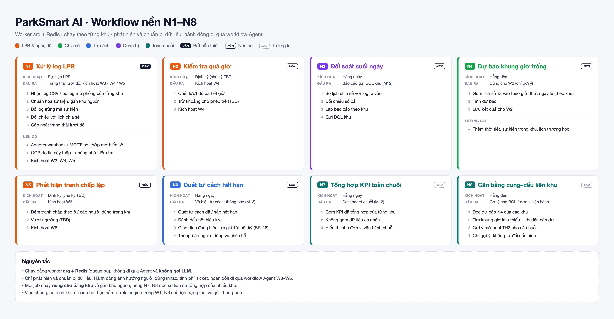

# Backlog — Workflow nền

> **File này trả lời:** job nền nào làm trong 4 tuần, chạy thế nào, tạo ra gì.
> Liên quan: [README](README.md) · [Module](01-modules.md) · [Workflow Agent](02-agent-workflows.md)

**Nguyên tắc**
- Worker arq + Redis (queue `bg`); không đi qua Agent, không gọi LLM.
- Job chỉ phát hiện và chuẩn bị dữ liệu; hành động đổi quyền hoặc tiền của người dùng đi qua workflow Agent.
- Mỗi job chạy riêng cho từng khu và gắn khu nguồn.
- Demo không có outbox: job ghi dữ liệu và gọi port `platform.publish()` ([ADR-0011](../../07-adr/ADR-0011-mvp-simplifications.md)).

## 1. Phạm vi theo mức

| Job | Ưu tiên 1 | Ưu tiên 2 | Không làm |
|-----|-----------|--------------------|-----------|
| **N1** Xử lý log LPR | Nạp CSV mô phỏng theo khu, chuẩn hóa, chống trùng, gắn khu nguồn, cập nhật giờ vào / ra của booking (tuần 2) | — | Webhook / MQTT, so khớp mờ, hàng chờ OCR thấp, kích hoạt W3 / W5 từ LPR, LPR thật |
| **N2** Nhắc quá giờ | — | Phát hiện booking sắp / đã hết giờ mà xe còn trong bãi, gửi 2 nhắc (tuần 3) | Nhắc thêm lần, thông báo chủ chỗ, bảng ca quá giờ |
| **N3–N8** | — | — | Đối soát, dự báo, tranh chấp lặp, quét tư cách hết hạn, KPI chuỗi, cân bằng liên khu |

Chặn tư cách hết hạn **không** cần N6: rule engine kiểm tra hạn ngay trong W1.
KPI dùng view `kpi_daily_v` đọc trực tiếp, không cần job tổng hợp.

## 2. N1 — Xử lý log LPR *(M8, `access/`)*

Biến log camera biển số mô phỏng thành sự kiện vào / ra sạch, gắn đúng khu, để dashboard và demo có dữ liệu ra vào thật.

- **Kích hoạt:** lệnh nạp file CSV (CLI hoặc endpoint dev) → enqueue job theo khu.
- **Đầu vào:** CSV có `source_code`, `source_event_id`, `gate_code`, hướng, thời điểm, biển số, độ tin cậy OCR.
- **Đầu ra:** dòng `lpr_event`; `booking.checked_in_at / checked_out_at` khi khớp lượt đỗ.

`Đọc CSV → Chuẩn hóa sự kiện, gắn khu nguồn → Mã hóa biển số, lưu hash và bản ẩn (`plate_ciphertext`, `plate_hash`, `plate_masked`) → Bỏ dòng trùng (zone_id, source_code, source_event_id) → Khớp với booking đang hiệu lực → Ghi giờ vào / ra`

**Bộ dữ liệu mô phỏng** (vai trò Hạ tầng & vận hành, tuần 2; thêm kịch bản demo ở tuần 3): ngày thường, cuối tuần, Tết cho 3 khu; có dòng trùng và dòng OCR thấp để test chống trùng.

## 3. N2 — Nhắc quá giờ *(M9, `access/`)*

Phát hiện người thuê sắp hết giờ hoặc đã hết giờ mà xe còn trong bãi, gửi nhắc. Không tính phí (phí tính khi xe ra: W4) và không có bảng "ca quá giờ".

- **Kích hoạt:** cron ~5 phút, chạy riêng từng khu.
- **Ứng viên:** booking `confirmed`, đã có giờ vào, chưa có giờ ra.
- **Đầu ra:** tối đa 2 `notification` mỗi booking, khóa idempotent `overstay_pre:<booking_id>` và `overstay_due:<booking_id>`; chạy lại không gửi trùng.

| Thời điểm | Điều kiện | Nội dung |
|-----------|-----------|----------|
| Trước giờ kết thúc 20 phút | `now() ≥ giờ kết thúc − 20 phút` | Sắp hết giờ |
| Đúng lúc hết giờ | `now() ≥ giờ kết thúc` | Nêu 10 phút cho phép và mức phí (12 500 đ / 15 phút) |

Không nhắc thêm. Tham số lấy từ `zone_policy` (mặc định, BQL xác nhận: A-07, D-03).

## 4. Kiểm thử

| Test | Kỳ vọng |
|------|---------|
| Nạp cùng file hai lần | Số dòng `lpr_event` không đổi (BR-13) |
| Sự kiện của khu A | Không thấy được dưới vai trò BQL khu B (RLS) |
| Sự kiện vào khớp booking | `checked_in_at` được ghi một lần |
| Chạy N2 hai lần cho cùng booking | Mỗi loại nhắc chỉ có một `notification` |
