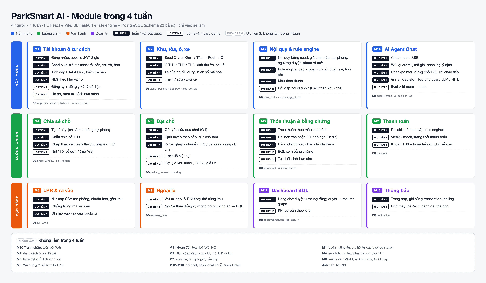

# Backlog ParkSmart AI — việc cần làm trong 4 tuần (4 người)

> **File này trả lời:** 4 tuần tới làm gì, ai làm, tuần nào xong; cái gì **không** làm.
> Chi tiết: [Module](01-modules.md) · [Workflow AI Agent](02-agent-workflows.md) · [Workflow nền](03-background-workflows.md)
> Liên quan: [PRD](../02-prd.md) · [Scope](../03-scope.md) · [Traceability](../06-traceability.md) · Schema 23 bảng: [03-design](../../03-design/README.md)

Xuất phát điểm (2026-11-19): server mới có khung `platform/` và guardrail, eval 4 case; chưa có migration, client, hạ tầng.
Vì vậy backlog chỉ giữ **một luồng chính làm trọn** và vài phần làm demo thuyết phục; mọi thứ khác nằm ở §5.

## 1. Ba mức ưu tiên

| Mức | Hạn | Ý nghĩa |
|-----|-----|---------|
| **Ưu tiên 1** | Hết tuần 2 | Luồng chính *yêu cầu → tư cách → định tuyến → ghép → thỏa thuận → bằng chứng xác nhận* chạy trên 2 khu, có BQL duyệt vượt ngưỡng và ẩn danh trước LLM; log LPR mô phỏng nạp được (N1) để có dữ liệu ra vào. |
| **Ưu tiên 2** | Hết tuần 4 (trước demo) | Thanh toán VietQR mock, chủ về sớm (W3), hỏi đáp nội quy (W7), gợi ý khu khác, KPI, **eval ≥45 case + trace**. |
| **Ưu tiên 3** | Không làm trong 4 tuần | Đã thiết kế nhưng không code. Danh sách ở §5. Chỉ mở khi Ưu tiên 1–2 xong hết. |

## 2. Tóm tắt theo nhóm

| Nhóm | Ưu tiên 1 | Ưu tiên 2 |
|------|-----------|-----------|
| [Module](01-modules.md) | M1–M6, M8 (N1), M12 (HITL), M13 (trong app), M14 | M7 (VietQR), M9 (W3), M12 (KPI); bổ sung M1, M2, M5, M6 |
| [Workflow Agent](02-agent-workflows.md) | W0, W1, W2 (đến bằng chứng xác nhận) | Thanh toán cuối W2, W3 (từ app), W7, FR-27 trong W1 |
| [Workflow nền](03-background-workflows.md) | N1 cơ bản (CSV mô phỏng, chống trùng) | — |

## 3. Lịch 4 tuần × 4 vai trò

Vai trò theo [Tech stack](../../02-architecture/02-tech-stack.md#gợi-ý-chia-việc-4-người). Mỗi ô là **đầu ra** cuối tuần.

| Tuần | Server core | AI Agent | Client | Hạ tầng & vận hành |
|------|-------------|----------|--------|--------------------|
| **1** | Migration 23 bảng + RLS, seed 3 khu; đăng nhập JWT 8 giờ; rule engine L1–L4 × phạm vi mở có unit test | W0: guardrail, mã giả, phân loại ý định, stream SSE; `agent_thread`, `ai_decision_log`; 15 case eval | Khung SPA, đăng nhập, client sinh từ OpenAPI, màn hình chat | docker compose (api, worker, postgres, redis), CI chạy `make check`, môi trường dev chung |
| **2** | API chia sẻ, đặt chỗ, thỏa thuận + OTP (Redis), `consent_record`, hàng chờ duyệt, thông báo | W1 định tuyến + giữ chỗ; W2 ghép → thỏa thuận → HITL (checkpointer, resume); 30 case eval | Màn hình chia sẻ, kết quả ghép, thỏa thuận + OTP, BQL duyệt, thông báo | **N1 nạp CSV LPR mô phỏng + chống trùng**, bộ log 3 khu; deploy EC2 + RDS (Terraform tối thiểu), OTel → LGTM; **demo nội bộ luồng chính** |
| **3** | VietQR mock + `payment`; `recovery_case` + API "Tôi về sớm"; đăng ký + đồng ý; xe; view `kpi_daily_v` | W3 chủ về sớm; W7 RAG nội quy (`knowledge_chunk`); FR-27 gợi ý khu khác | Màn hình thanh toán, về sớm, đăng ký, xe, hỏi đáp nội quy, dashboard KPI | Bộ log ngày thường / cuối tuần / Tết cho kịch bản demo; alert cơ bản (ADR-0008) |
| **4** | Sửa lỗi, test tích hợp Postgres thật, hoàn thiện RLS | Eval **≥45 case** + LLM-judge, báo cáo `make eval`, trace đầy đủ | Hoàn thiện UI, trạng thái lỗi / rỗng | Dashboard Grafana, chạy thử kịch bản demo 2–3 khu; slide |

**Mốc kiểm tra:** cuối tuần 2 luồng chính chạy end-to-end trên môi trường deploy; cuối tuần 3 đóng băng tính năng; tuần 4 chỉ sửa lỗi, eval, demo.

## 4. Truy vết FR → module / workflow

| FR | Module | Workflow | Mức |
|----|--------|----------|-----|
| FR-01 → FR-04, FR-23, FR-24 | M1, M3, M5 | W1 | 1 |
| FR-06, FR-07 | M4 | W2 | 1 |
| FR-08, FR-09 | M6 | W2 | 1 |
| FR-09a | M12 | W2 (HITL) | 1 |
| FR-21 | M3, M7 | W2 | 1 (tính phí theo cấp) · 2 (VietQR mock) |
| FR-25 | M1 | W1 | 1 (chặn khi xử lý yêu cầu) · 3 (quét, thông báo N6) |
| FR-26 | M3 | W1, W2 | 1 (cấu hình pool bằng seed) · 3 (chủ chỗ thu hẹp) |
| FR-10 | M9 | W3 | 2 (từ app) · 3 (từ LPR) |
| FR-16a, FR-19 | M8 | N1 | 1 (CSV, chống trùng) · 3 (webhook / MQTT, so khớp mờ, OCR thấp) |
| FR-27 | M5 | W1 | 2 |
| FR-05, FR-11 → FR-18, FR-20, FR-22 | M4, M7, M9, M10, M11 | W4, W5, W6, N2–N5 | 3 |

## 5. Không làm trong 4 tuần (Ưu tiên 3)

Đã có thiết kế; bảng DB tương ứng nằm ở [08-deferred-tables](../../03-design/08-deferred-tables.md).

| Nhóm | Không làm |
|------|-----------|
| M1 Tài khoản | Quên mật khẩu, rút đồng ý, BQL thu hồi tư cách, refresh token, ủy quyền, eKYC |
| M2 Khu, ô, xe | Danh sách ô và trạng thái, sơ đồ bãi realtime, bản vẽ, ô sạc điện |
| M3 Nội quy | BQL sửa nội quy qua UI, lịch sử cấu hình, mở TH1 ra cả khu (A-08), giá cao điểm |
| M4 Chia sẻ | Sửa lịch, chủ chỗ thu hẹp phạm vi, dự báo giờ trống (N4), thu nhập, lặp lịch |
| M5 Đặt chỗ | Form đặt chỗ ngoài chat, lịch sử / hủy đặt chỗ, đặt định kỳ |
| M6 Thỏa thuận | Xuất dữ liệu, chữ ký số, chuỗi hash |
| M7 Thanh toán | Voucher shophouse, phí quá giờ, lịch sử giao dịch, thanh toán thật |
| M8 LPR | Webhook / MQTT, so khớp mờ, hàng chờ OCR thấp, LPR kích hoạt W3–W5 |
| M9 Ngoại lệ | W4 quá giờ, phát hiện về sớm từ LPR, gợi ý khu lân cận khi hết TH3, bù chi phí |
| M10, M11 | Toàn bộ tranh chấp (W5) và hoán đổi (W6, N5) |
| M12, M13 | Đối soát N3, dashboard chuỗi (N7, N8), Agent hỗ trợ BQL; WebSocket realtime (dùng polling), push / Zalo / SMS |
| M14 Agent | Bộ nhớ hội thoại dài hạn, giọng nói, đa ngôn ngữ |
| Job nền | N2–N8 |

## 6. Ảnh

Ảnh workflow: [Agent](02-agent-workflows.md) · [nền](03-background-workflows.md). Nếu ảnh và văn bản lệch, văn bản đúng.
