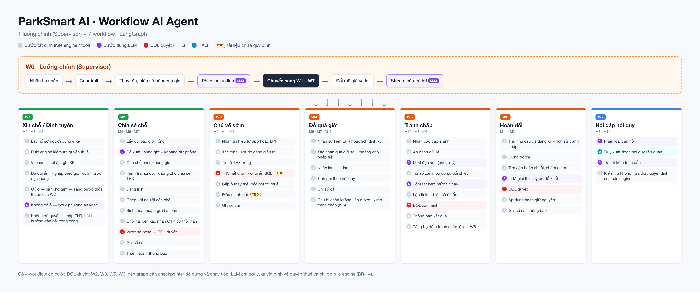

# Backlog — Workflow AI Agent

> Tổng quan và định nghĩa mức ưu tiên: [README](README.md) · [Module](modules.md) · [Workflow nền](background-workflows.md)
> Nguồn ban đầu: [ParkSmartAI-agent-workflows.png](../../images/ParkSmartAI-agent-workflows.png) (W0 Supervisor + W1–W7, LangGraph). Đã cập nhật theo mô hình chuỗi N khu.

*Ảnh là bản trước khi chuyển sang mô hình chuỗi N khu. Khi ảnh và nội dung bên dưới khác nhau, nội dung bên dưới là bản đúng.*

**Loại bước:** `[TĐ]` tất định (rule engine / tool) · `[LLM]` dùng LLM · `[HITL]` BQL duyệt · `[RAG]` truy xuất nội quy.

**Nguyên tắc:**
- LLM chỉ gợi ý. Quyết định về tư cách, quyền thuê và phí do rule engine đưa ra (BR-14).
- Các workflow có bước BQL duyệt (W2, W3, W5, W6) cần checkpointer để dừng chờ duyệt rồi chạy tiếp.
- BQL duyệt luôn là **BQL của khu có ô đỗ** (BR-18).

| Workflow | Module | Rất cần thiết | Nên có | Tương lai |
|----------|--------|:---:|:---:|:---:|
| W0 Supervisor | M14 | ● | ○ | ○ |
| W1 Xin chỗ / định tuyến | M5 · M3 · M1 · M2 | ● | ○ | ○ |
| W2 Chia sẻ chỗ | M4 · M6 · M7 | ● | ○ | — |
| W3 Chủ về sớm | M9 · M4 · M5 | ● | ○ | ○ |
| W4 Đỗ quá giờ | M9 · M7 · M13 | — | ● | — |
| W5 Tranh chấp | M10 · M8 · M6 | — | ● | — |
| W6 Hoán đổi | M11 · M2 | — | ● | ○ |
| W7 Hỏi đáp nội quy | M3 · M14 | — | ● | ○ |

● = phần chính của workflow nằm ở mức này · ○ = có bổ sung ở mức này

## 1. Rất cần thiết

**W0 — Luồng chính (Supervisor)**
1. `[TĐ]` Nhận tin nhắn
2. `[TĐ]` Guardrail
3. `[TĐ]` Thay tên, biển số bằng mã giả
4. `[LLM]` Phân loại ý định
5. `[TĐ]` Chuyển sang W1–W3
6. `[TĐ]` Đổi mã giả về giá trị thật
7. `[LLM]` Stream câu trả lời

**W1 — Xin chỗ / định tuyến**
1. `[TĐ]` Lấy hồ sơ người dùng và xe
2. `[TĐ]` **Tính cấp tư cách L1–L4 tại khu / tòa của ô được yêu cầu.** Bước này kiểm tra hạn tư cách; với khu khác chỉ dùng kết quả xác nhận (cấp, hạn).
3. `[TĐ]` Rule engine kiểm tra quyền thuê: cấp tư cách × phạm vi mở của pool
4. `[TĐ]` Vi phạm → chặn, ghi KPI "sai tư cách / sai phạm vi"
5. `[TĐ]` Đủ quyền → ghép theo giờ, kích thước, dự phòng
6. `[TĐ]` Có ô → giữ chỗ tạm → sang bước thỏa thuận của W2
7. `[TĐ]` Không đủ quyền → cấp TH3 của khu với giá theo cấp; nếu TH3 hết thì hướng dẫn tới bãi công cộng

**W2 — Chia sẻ chỗ**
1. `[TĐ]` Chủ chỗ chọn khung giờ
2. `[TĐ]` Kiểm tra nội quy; không cho chia sẻ TH3
3. `[TĐ]` Đăng lịch, kèm khoảng dự phòng
4. `[TĐ]` Ghép với người cần chỗ (theo phạm vi mở)
5. `[TĐ]` Sinh thỏa thuận theo mẫu của khu có ô, gửi cho hai bên
6. `[TĐ]` Chờ hai bên xác nhận bằng OTP, có thời hạn
7. `[HITL]` Vượt ngưỡng của khu → BQL khu duyệt
8. `[TĐ]` Ghi sổ cái
9. `[TĐ]` Thanh toán (VietQR mock), thông báo

**W3 — Chủ về sớm** (kích hoạt từ app)
1. `[TĐ]` Nhận tín hiệu "Tôi về sớm" từ app
2. `[TĐ]` Xác định lượt đỗ đang diễn ra
3. `[TĐ]` Tìm ô TH3 trống **cùng khu**
4. `[TĐ]` Cấp ô thay thế, báo người thuê
5. `[TĐ]` Ghi sổ cái

## 2. Nên có

**Bổ sung cho W0:** chuyển thêm sang W4–W7; bộ nhớ hội thoại; trích dẫn nguồn; eval và trace.

**Bổ sung cho W1:**
- `[LLM]` Không có ô → gợi ý phương án khác, gồm **ô ở khu khác trong chuỗi** mà người dùng đủ điều kiện (FR-27). Người dùng tự chọn; Agent không tự đặt.

**Bổ sung cho W2:**
- `[TĐ]` Lấy dự báo giờ trống (từ N4)
- `[LLM]` Đề xuất khung giờ và khoảng dự phòng
- `[TĐ]` Chủ chỗ **chọn phạm vi chia sẻ** (chỉ thu hẹp, không vượt nội quy)

**Bổ sung cho W3:**
- `[TĐ]` Nhận tín hiệu từ LPR (N1), ngoài tín hiệu từ app
- `[TĐ]` TH3 cùng khu hết chỗ → gợi ý TH3 ở khu lân cận
- `[HITL]` Không có phương án nào → chuyển BQL khu

**W4 — Đỗ quá giờ**
1. `[TĐ]` Nhận sự kiện LPR hoặc từ N2
2. `[TĐ]` Xác nhận quá giờ sau khoảng cho phép trễ (TBD)
3. `[TĐ]` Nhắc lần 1 … lần n
4. `[TĐ]` Tính phí theo nội quy của khu
5. `[TĐ]` Ghi sổ cái
6. `[TĐ]` Chủ chỗ bị chặn không vào được → mở tranh chấp (W5)

**W5 — Tranh chấp**
1. `[TĐ]` Nhận báo cáo kèm ảnh
2. `[TĐ]` Ẩn danh dữ liệu
3. `[LLM]` Đọc ảnh (chỉ để gợi ý)
4. `[TĐ]` Tra sổ cái và log cổng của khu, đối chiếu
5. `[LLM]` Tóm tắt kèm mức tin cậy
6. `[TĐ]` Lập ticket, biển số đã ẩn
7. `[HITL]` BQL của khu có ô xác minh (kể cả khi một bên là thành viên khu khác)
8. `[TĐ]` Thông báo kết quả
9. `[TĐ]` Tăng bộ đếm tranh chấp lặp (dùng cho N5)

**W6 — Hoán đổi 2 bên**
1. `[TĐ]` Thu nhu cầu đã đăng ký và lịch sử tranh chấp
2. `[TĐ]` Dựng đồ thị, **chỉ gồm các ô trong cùng một khu**
3. `[TĐ]` Tìm cặp hoán đổi, chấm điểm
4. `[HITL]` BQL khu duyệt
5. `[TĐ]` Áp dụng hoặc giữ nguyên
6. `[TĐ]` Ghi sổ cái, thông báo

**W7 — Hỏi đáp nội quy**
1. `[LLM]` Phân loại câu hỏi
2. `[RAG]` Truy xuất đoạn nội quy liên quan, **lọc theo khu / tòa** của người hỏi
3. `[LLM]` Trả lời kèm trích dẫn
4. `[TĐ]` Kiểm tra câu trả lời không hứa hẹn thay cho quyết định của rule engine

## 3. Có thể trong tương lai

| Workflow | Bổ sung |
|----------|---------|
| W0 | Nhập bằng giọng nói; đa ngôn ngữ |
| W1 | Đặt chỗ định kỳ (cả tuần) ở khu khác |
| W3 | `[TĐ]` Điều chỉnh phí / bù chi phí cho người thuê (đang TBD) |
| W6 | Hoán đổi **theo chuỗi** nhiều bên; `[LLM]` giải thích lý do đề xuất |
| W7 | Hỏi đáp nội quy so sánh giữa các khu |
| (mới) | Agent hỗ trợ BQL: tóm tắt tình hình trong ngày của khu, gợi ý mở pool TH2 cho cả chuỗi dựa trên N8 |
