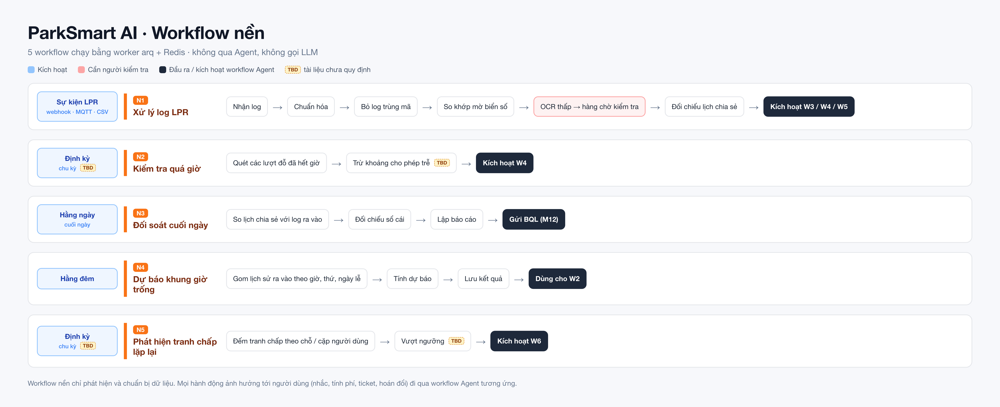

# Backlog — Workflow nền

> Tổng quan và định nghĩa mức ưu tiên: [README](README.md) · [Module](modules.md) · [Workflow AI Agent](agent-workflows.md)
> Nguồn ban đầu: [ParkSmartAI-background-workflows.png](../../images/ParkSmartAI-background-workflows.png) (N1–N5). Đã cập nhật theo mô hình chuỗi N khu; thêm N6–N8.

*Ảnh là bản trước khi chuyển sang mô hình chuỗi N khu (chưa có N6–N8). Khi ảnh và nội dung bên dưới khác nhau, nội dung bên dưới là bản đúng.*

**Nguyên tắc:**
- Workflow nền chạy bằng worker arq + Redis, không đi qua Agent và không gọi LLM.
- Workflow nền chỉ phát hiện và chuẩn bị dữ liệu. Mọi hành động ảnh hưởng tới người dùng (nhắc, tính phí, ticket, hoán đổi) đi qua workflow Agent tương ứng.
- Mọi job chạy **riêng cho từng khu** và gắn khu nguồn vào dữ liệu. Riêng N7 và N8 đọc số liệu đã tổng hợp của nhiều khu.

| Workflow | Kích hoạt | Đầu ra | Rất cần thiết | Nên có | Tương lai |
|----------|-----------|--------|:---:|:---:|:---:|
| N1 Xử lý log LPR | Sự kiện LPR | Trạng thái lượt đỗ; kích hoạt W3 / W4 / W5 | ● | ○ | ○ |
| N2 Kiểm tra quá giờ | Định kỳ (chu kỳ TBD) | Kích hoạt W4 | — | ● | — |
| N3 Đối soát cuối ngày | Hằng ngày | Báo cáo gửi BQL khu (M12) | — | ● | — |
| N4 Dự báo khung giờ trống | Hằng đêm | Dùng cho W2 | — | ● | ○ |
| N5 Phát hiện tranh chấp lặp | Định kỳ (chu kỳ TBD) | Kích hoạt W6 | — | ● | — |
| N6 Quét tư cách hết hạn | Hằng ngày | Vô hiệu tư cách; thông báo (M13) | — | ● | — |
| N7 Tổng hợp KPI toàn chuỗi | Hằng ngày | Dashboard chuỗi (M12) | — | — | ● |
| N8 Cân bằng cung–cầu liên khu | Hằng đêm | Gợi ý cho BQL / đơn vị vận hành | — | — | ● |

● = phần chính của workflow nằm ở mức này · ○ = có bổ sung ở mức này

## 1. Rất cần thiết

**N1 — Xử lý log LPR (bản cơ bản)**
1. Nhận log từ CSV / bộ log mô phỏng (ngày thường, cuối tuần, Tết) của từng khu
2. Chuẩn hóa sự kiện, gắn khu nguồn
3. Bỏ log trùng mã sự kiện
4. Đối chiếu với lịch chia sẻ
5. Cập nhật trạng thái lượt đỗ

Ở mức này, W3 được kích hoạt từ app. N1 chưa kích hoạt workflow Agent nào.

## 2. Nên có

**Bổ sung cho N1:**
- Adapter webhook / MQTT
- So khớp mờ biển số đọc sai
- OCR có độ tin cậy thấp → hàng chờ để người kiểm tra
- Kích hoạt W3 (chủ về sớm), W4 (quá giờ), W5 (dấu hiệu tranh chấp)

**N2 — Kiểm tra quá giờ:** quét các lượt đỗ đã hết giờ → trừ khoảng cho phép trễ (TBD) → kích hoạt W4.

**N3 — Đối soát cuối ngày:** so lịch chia sẻ với log ra vào → đối chiếu sổ cái → lập báo cáo theo khu → gửi BQL khu (M12).

**N4 — Dự báo khung giờ trống:** gom lịch sử ra vào theo giờ, thứ, ngày lễ (theo khu) → tính dự báo → lưu kết quả → dùng cho W2. Kết quả chỉ để gợi ý, không tự đăng lịch.

**N5 — Phát hiện tranh chấp lặp lại:** đếm tranh chấp theo ô / cặp người dùng trong khu → vượt ngưỡng (TBD) → kích hoạt W6.

**N6 — Quét tư cách hết hạn** *(mới)*
1. Quét các tư cách có hạn hiệu lực đã qua (và các tư cách sắp hết hạn)
2. Đánh dấu tư cách hết hiệu lực
3. Tìm giao dịch đang hiệu lực dựa trên các tư cách đó; giữ tới hết kỳ (BR-16)
4. Gửi thông báo cho người dùng và chủ chỗ liên quan (M13)

Việc chặn giao dịch mới không phụ thuộc N6: rule engine đã kiểm tra hạn ngay trong W1. N6 chỉ dọn trạng thái và gửi thông báo.

## 3. Có thể trong tương lai

**Bổ sung cho N1:** nhận log từ hệ thống LPR thật của đơn vị trông giữ xe.

**Bổ sung cho N4:** mô hình dự báo tốt hơn (thời tiết, sự kiện trong khu, lịch trường học).

**N7 — Tổng hợp KPI toàn chuỗi** *(mới)*: gom KPI đã tổng hợp của từng khu (không gom dữ liệu cá nhân) → dashboard cho đơn vị vận hành chuỗi.

**N8 — Cân bằng cung–cầu liên khu** *(mới)*: từ dự báo N4 của các khu, tìm khung giờ khu này thiếu chỗ còn khu lân cận dư chỗ → gợi ý cho BQL / đơn vị vận hành (ví dụ mở pool TH2 cho cả chuỗi trong khung giờ đó). Chỉ là gợi ý, không tự đổi cấu hình.
