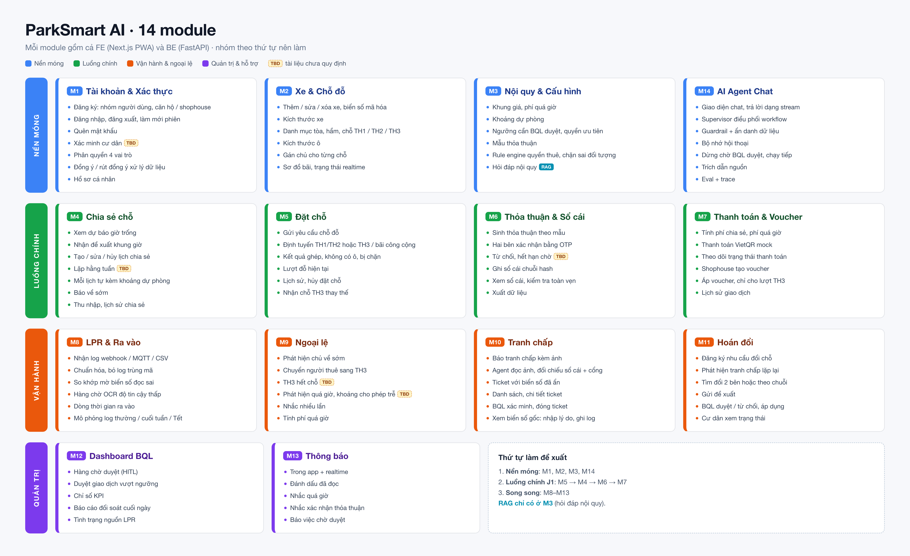

# Backlog — Module (FE / BE)

> Tổng quan và định nghĩa mức ưu tiên: [README](README.md) · Workflow: [AI Agent](agent-workflows.md) · [Nền](background-workflows.md)
> Nguồn ban đầu: [ParkSmartAI-modules.png](../../images/ParkSmartAI-modules.png) (14 module). Tài liệu này đã cập nhật theo mô hình chuỗi N khu và tư cách L1–L4 ([PRD §3](../prd.md#3-đối-tượng-người-dùng-và-tư-cách)).

*Ảnh là bản trước khi chuyển sang mô hình chuỗi N khu. Khi ảnh và nội dung bên dưới khác nhau, nội dung bên dưới là bản đúng.*

**FE** = Next.js PWA · **BE** = FastAPI, rule engine, Supabase. Một module có thể có tính năng ở cả 3 mức. "—" nghĩa là không có tính năng nào ở mức đó.

| Nhóm | Module |
|------|--------|
| Nền móng | M1 Tài khoản & tư cách · M2 Khu, tòa, xe, chỗ đỗ · M3 Nội quy & cấu hình · M14 AI Agent Chat |
| Luồng chính | M4 Chia sẻ chỗ · M5 Đặt chỗ · M6 Thỏa thuận & sổ cái · M7 Thanh toán & voucher |
| Vận hành | M8 LPR & ra vào · M9 Ngoại lệ · M10 Tranh chấp · M11 Hoán đổi |
| Quản trị | M12 Dashboard · M13 Thông báo |

## 1. Rất cần thiết

| Module | FE | BE |
|--------|----|----|
| **M1 Tài khoản & tư cách** | Đăng ký, đăng nhập, đăng xuất; hồ sơ cá nhân; xem danh sách tư cách của mình (khu, tài sản, vai trò, hạn); đồng ý xử lý dữ liệu | Supabase Auth; 5 vai trò (cư dân / người thuê, bảo vệ, BQL khu, đơn vị vận hành chuỗi); bảng tư cách *(tài sản, vai trò, hạn)*; seed tư cách mô phỏng cho các khu; hàm tính cấp L1–L4 tại một ô; kiểm tra hạn tư cách ngay khi xử lý yêu cầu; RLS theo khu và theo hộ; API xác nhận tư cách liên khu chỉ trả về cấp và hạn |
| **M2 Khu, tòa, xe, chỗ đỗ** | Thêm, sửa, xóa xe (biển số, kích thước); chọn khu / tòa; danh sách ô và trạng thái | Mô hình Chuỗi → Khu → Phân khu → Tòa → Hầm → Ô; loại ô TH1/TH2/TH3; kích thước ô; chủ ô; biển số mã hóa khi lưu |
| **M3 Nội quy & cấu hình** | — (cấu hình bằng seed) | Cấu hình theo khu và tòa: khung giá theo cấp tư cách, khoảng dự phòng, ngưỡng cần BQL duyệt, **phạm vi mở của từng pool**; rule engine: quyền thuê theo cấp × phạm vi mở, chặn giao dịch sai tư cách / sai phạm vi, tính phí; mẫu thỏa thuận |
| **M14 AI Agent Chat** | Giao diện chat, trả lời dạng stream; hiển thị yêu cầu đang chờ BQL duyệt | W0 Supervisor; guardrail; thay tên / biển số bằng mã giả và khôi phục; phân loại ý định; checkpointer để dừng chờ duyệt rồi chạy tiếp |
| **M5 Đặt chỗ** | Gửi yêu cầu (khu, tòa, khung giờ, xe) qua chat hoặc form; kết quả: được ghép / chuyển TH3 / bị chặn kèm lý do; lượt đỗ hiện tại | W1: định tuyến theo cấp tư cách; giữ chỗ tạm; chuyển TH3 / bãi công cộng với giá theo cấp |
| **M4 Chia sẻ chỗ** | Tạo, sửa, hủy lịch chia sẻ; nút "Tôi về sớm" | Lưu lịch kèm khoảng dự phòng; chặn chia sẻ TH3; ghép cung–cầu theo giờ, kích thước và phạm vi mở |
| **M6 Thỏa thuận & sổ cái** | Xem thỏa thuận; xác nhận bằng OTP | Sinh thỏa thuận theo mẫu của khu có ô; OTP có thời hạn; sổ cái append-only có chuỗi hash |
| **M7 Thanh toán & voucher** | Màn hình VietQR mock; trạng thái thanh toán | Tính phí chia sẻ theo cấp tư cách; trạng thái thanh toán mô phỏng |
| **M9 Ngoại lệ** | (dùng nút "Tôi về sớm" của M4) | W3 kích hoạt từ app: cấp ô TH3 thay thế cùng khu cho người thuê |
| **M8 LPR & ra vào** | — | N1 cơ bản: nạp CSV mô phỏng, chuẩn hóa, bỏ log trùng mã, gắn khu nguồn; bộ log mô phỏng (ngày thường, cuối tuần, Tết) cho các khu |
| **M12 Dashboard** | Hàng chờ duyệt cho BQL khu: duyệt / từ chối giao dịch vượt ngưỡng | API hàng chờ HITL lọc theo khu; resume graph sau khi duyệt |
| **M13 Thông báo** | Thông báo trong app, realtime; đánh dấu đã đọc | Supabase Realtime: kết quả ghép, nhắc xác nhận thỏa thuận, việc chờ duyệt, chỗ thay thế |
| M10, M11 | — | — |

## 2. Nên có

| Module | FE | BE |
|--------|----|----|
| **M1** | Quên mật khẩu; rút lại đồng ý; BQL khu xem, duyệt, thu hồi tư cách | N6 quét tư cách hết hạn và thông báo |
| **M2** | Sơ đồ bãi với trạng thái realtime | Cập nhật trạng thái ô từ sự kiện LPR |
| **M3** | BQL khu chỉnh cấu hình nội quy của khu mình; hỏi đáp nội quy (W7) | RAG nội quy lọc theo khu / tòa; lịch sử thay đổi cấu hình |
| **M4** | Xem dự báo giờ trống; nhận đề xuất khung giờ; **chọn phạm vi chia sẻ** (thu hẹp); thu nhập và lịch sử chia sẻ | Đề xuất khung giờ từ N4; ràng buộc phạm vi do chủ chỗ chọn không vượt nội quy |
| **M5** | Gợi ý chỗ ở khu khác khi hết chỗ; lịch sử và hủy đặt chỗ; nhận chỗ TH3 thay thế | Tìm ô ở khu khác mà người dùng đủ điều kiện (FR-27); giá cấp L3 |
| **M6** | Xem sổ cái; kiểm tra toàn vẹn | Thỏa thuận bị từ chối hoặc hết hạn chờ; API kiểm tra chuỗi hash |
| **M7** | Shophouse tạo voucher; khách áp voucher; lịch sử giao dịch | Voucher chỉ dùng cho lượt TH3; tính phí quá giờ |
| **M8** | Hàng chờ OCR thấp cho bảo vệ / BQL; dòng thời gian ra vào | Adapter webhook / MQTT; so khớp mờ biển số; kích hoạt W3 / W4 / W5 |
| **M9** | Nhắc quá giờ; thông báo phí | Phát hiện về sớm từ LPR; W4 quá giờ (nhắc nhiều lần, tính phí); TH3 hết chỗ → gợi ý khu lân cận |
| **M10 Tranh chấp** | Báo tranh chấp kèm ảnh; danh sách, chi tiết ticket; BQL xác minh, đóng ticket; xem biển số gốc (nhập lý do) | W5; ticket chuyển BQL của khu có ô; ghi log mỗi lần xem biển số gốc |
| **M11 Hoán đổi** | Đăng ký nhu cầu đổi chỗ; BQL duyệt / từ chối; cư dân xem trạng thái | W6 hoán đổi **2 bên** trong cùng khu; N5 phát hiện tranh chấp lặp lại |
| **M12** | KPI theo khu; báo cáo đối soát cuối ngày; tình trạng nguồn LPR; hàng chờ ticket và hoán đổi | N3 đối soát; tổng hợp KPI theo khu |
| **M13** | Nhắc quá giờ; tư cách sắp / đã hết hạn | Lịch gửi nhắc; gom thông báo |
| **M14** | Hiển thị trích dẫn nguồn | Bộ nhớ hội thoại; eval và trace |

## 3. Có thể trong tương lai

| Module | FE | BE |
|--------|----|----|
| **M1** | Ủy quyền cho người khác dùng tư cách | Đồng bộ với hệ thống quản lý cư dân thật của từng khu; eKYC |
| **M2** | Sơ đồ bãi dạng bản vẽ; chỉ đường tới ô | Thuộc tính ô có sạc xe điện và ghép theo thuộc tính này |
| **M3** | — | Mở TH1 ra cả khu (sau khi A-08 được xác nhận pháp lý); khung giá theo giờ cao điểm |
| **M4** | Lặp lịch hằng tuần | Tự tạo nháp lịch từ dự báo (chủ chỗ vẫn phải xác nhận) |
| **M5** | Đặt chỗ định kỳ (ví dụ cả tuần đưa đón con) | Giữ chỗ định kỳ liên khu |
| **M6** | Xuất dữ liệu | Chữ ký số |
| **M7** | Thanh toán thật (VietQR thật, MoMo, ZaloPay) | Đối soát tiền; chia doanh thu giữa chủ chỗ, BQL và đơn vị vận hành |
| **M8** | — | Tích hợp hệ thống LPR thật của đơn vị trông giữ xe |
| **M9** | — | Chính sách bù chi phí khi chủ về sớm (đang TBD) |
| **M10** | Khiếu nại lại kết quả | Thống kê tranh chấp theo khu |
| **M11** | — | Hoán đổi **theo chuỗi** nhiều bên; LLM giải thích lý do đề xuất |
| **M12** | Dashboard toàn chuỗi cho đơn vị vận hành; so sánh cung–cầu giữa các khu | N7, N8 |
| **M13** | Push notification, Zalo, SMS | Tích hợp kênh ngoài |
| **M14** | Nhập bằng giọng nói; đa ngôn ngữ | — |
