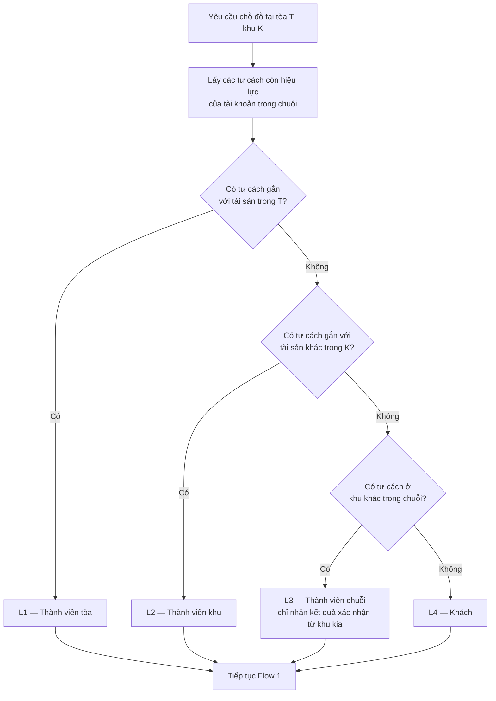
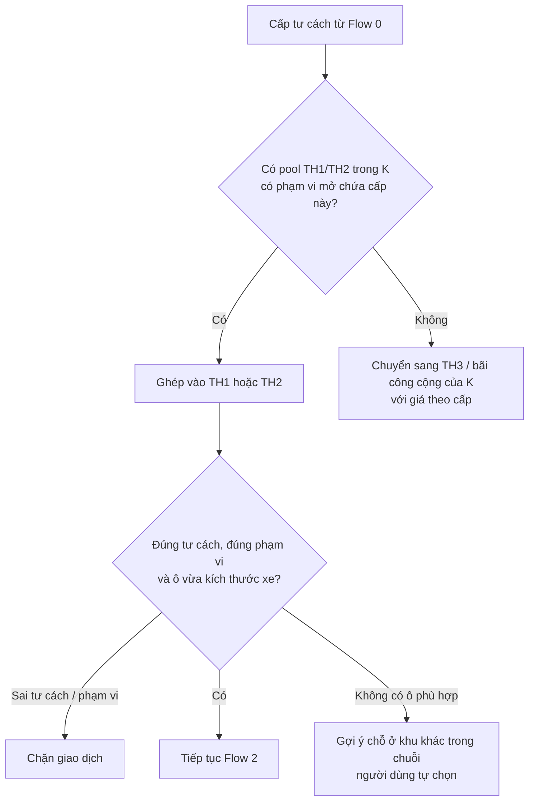
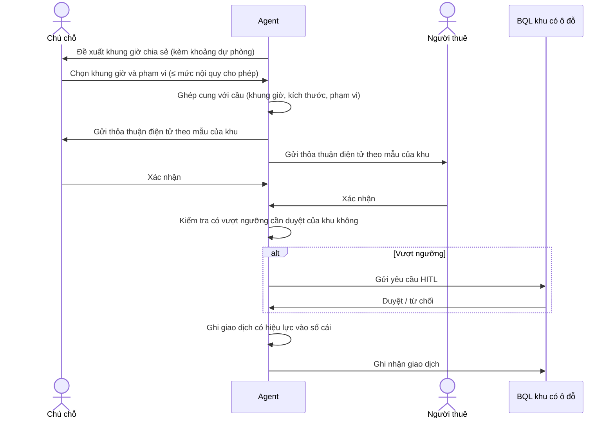
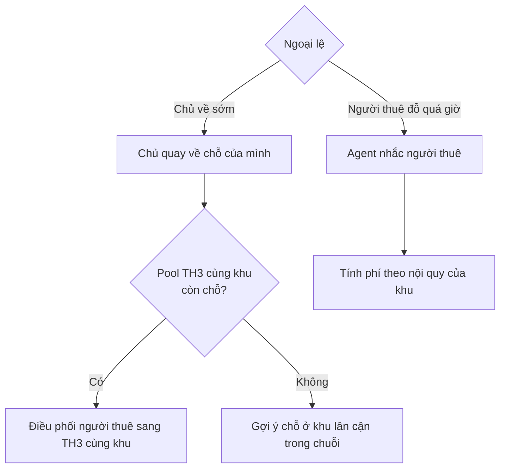
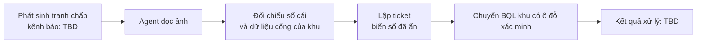
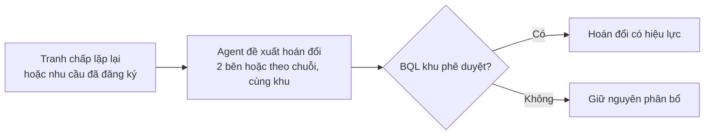
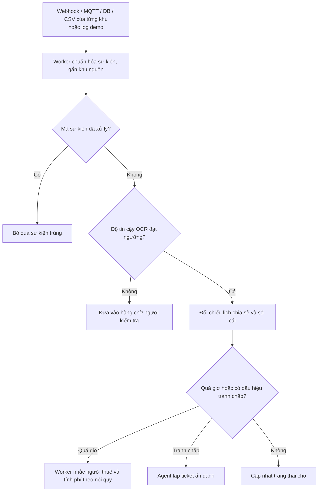

# User Flow — Agent điều phối quyền sử dụng chỗ đỗ trong chuỗi khu đô thị

> Nguồn: [01-xac-dinh-bai-toan.md](../../01-xac-dinh-bai-toan.md)
> Liên quan: [User Stories](../user-stories.md) · [Acceptance Criteria](../acceptance-criteria.md) · [PRD](../prd.md)
> Wireframes: [wireframes/index.html](wireframes/index.html) (chưa cập nhật cho bối cảnh nhiều khu) · UI design: [ui-design/](ui-design/) (chưa có)

Các luồng dưới đây thể hiện nghiệp vụ của bản demo (1 chuỗi, N khu). Agent điều phối các nhánh nghiệp vụ. Worker nền xử lý: nạp log LPR, nhắc quá giờ, đối soát cuối ngày, dự báo và quét tư cách hết hạn. Màn hình và thao tác UI cụ thể: TBD.

## Flow 0 — Xác định tư cách tại vị trí chỗ đỗ (US-19 → US-22)

## Flow 1 — Định tuyến yêu cầu chỗ đỗ (US-01 → US-03, US-25)

## Flow 2 — Chia sẻ chỗ (US-04 → US-08, US-23)

## Flow 3 — Xử lý ngoại lệ (US-09 → US-11)

## Flow 4 — Tranh chấp (US-12, US-13)

## Flow 5 — Hoán đổi (US-14, US-15)

## Flow 6 — Nạp và xử lý log LPR

Thông tin nhận dạng được ẩn danh trước khi gửi ngữ cảnh tới LLM. Log OCR không chắc chắn cần người kiểm tra; Agent không tự đưa ra phán quyết tranh chấp.
