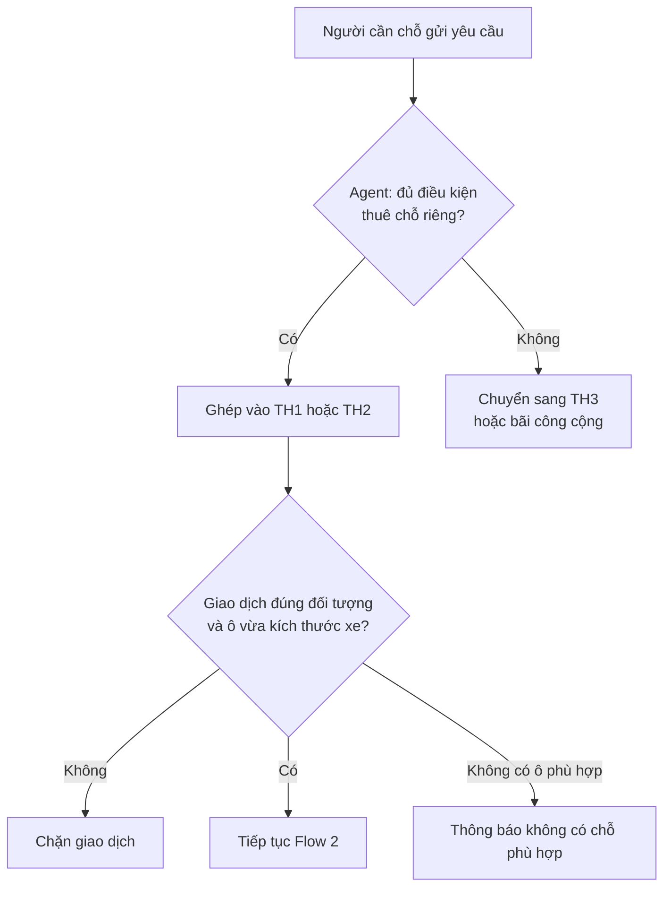
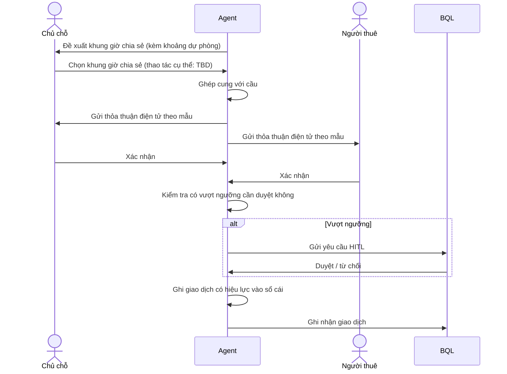
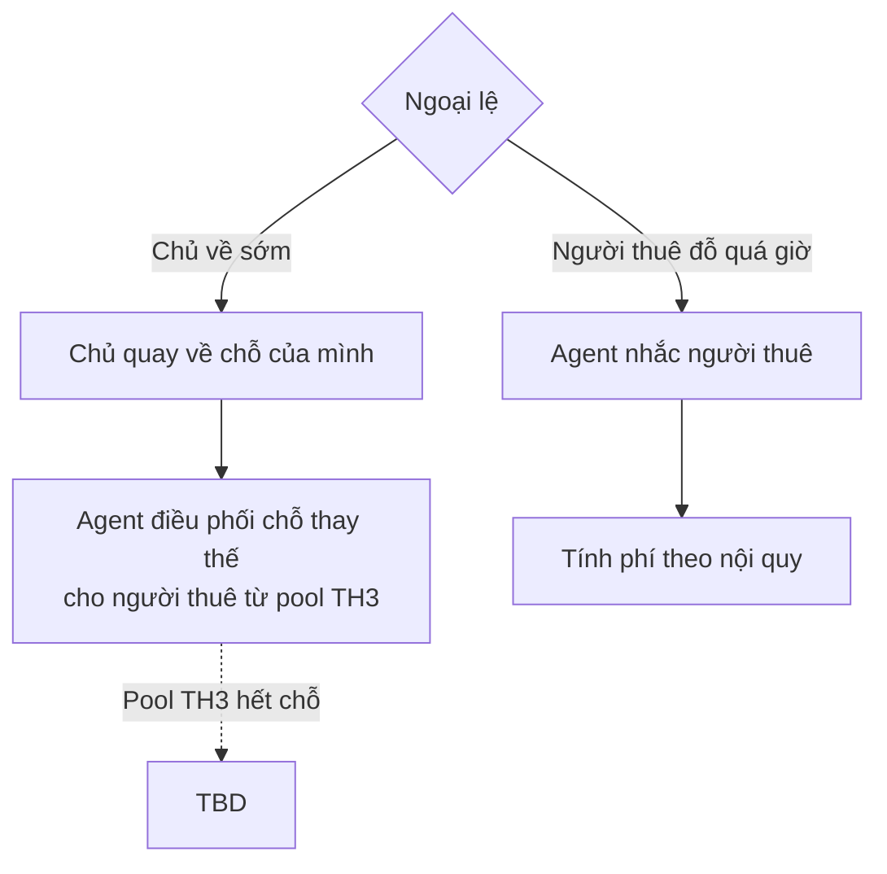
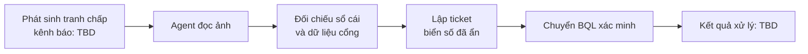
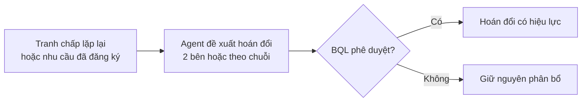
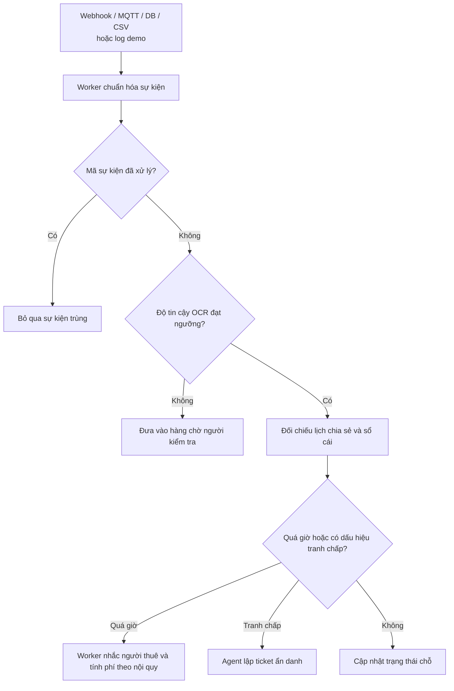

# User Flow — Agent điều phối quyền sử dụng chỗ đỗ

> Nguồn: [01-xac-dinh-bai-toan.md](../../01-xac-dinh-bai-toan.md)
> Liên quan: [User Stories](../user-stories.md) · [Acceptance Criteria](../acceptance-criteria.md) · [PRD](../prd.md)
> Wireframes: [wireframes/](wireframes/) (chưa có) · UI design: [ui-design/](ui-design/) (chưa có)

Các luồng thể hiện nghiệp vụ bản demo. Agent điều phối các nhánh nghiệp vụ; ingest LPR, nhắc quá giờ, đối soát cuối ngày và dự báo chạy qua worker nền. Màn hình và thao tác UI cụ thể: TBD.

## Flow 1 — Định tuyến yêu cầu chỗ đỗ (US-01 → US-03)

## Flow 2 — Chia sẻ chỗ (US-04 → US-08)

## Flow 3 — Xử lý ngoại lệ (US-09 → US-11)

## Flow 4 — Tranh chấp (US-12, US-13)

## Flow 5 — Hoán đổi (US-14, US-15)

## Flow 6 — Nạp và xử lý log LPR

Thông tin nhận dạng được ẩn danh trước khi gửi ngữ cảnh tới LLM. Log OCR không chắc chắn cần người kiểm tra; Agent không tự đưa ra phán quyết tranh chấp.
