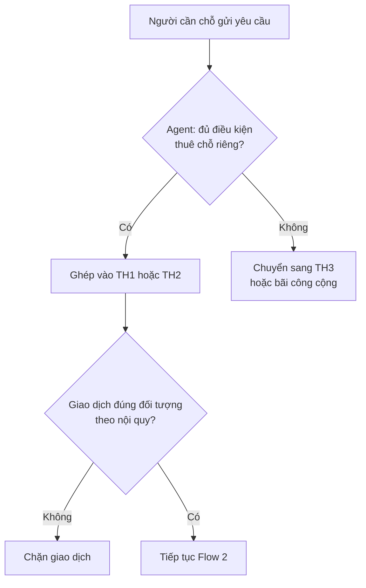
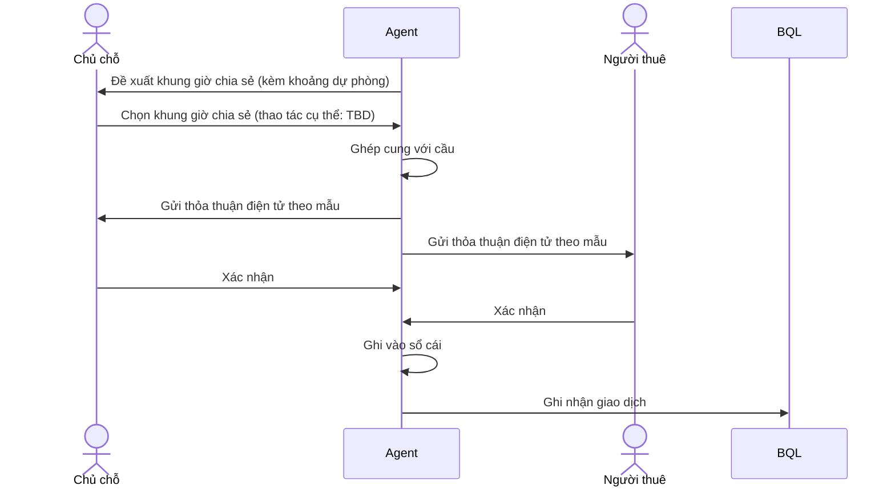
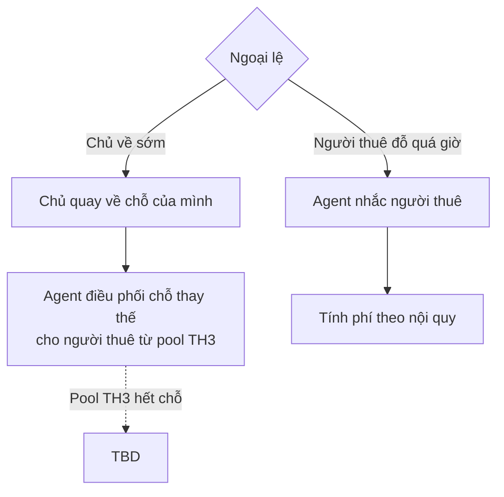
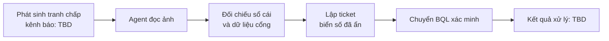
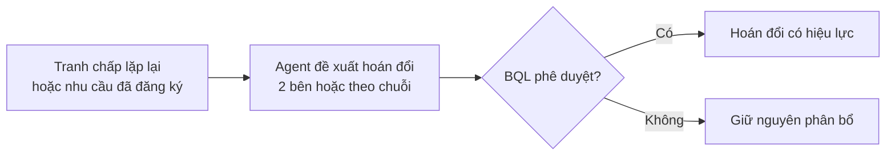

# User Flow — Agent điều phối quyền sử dụng chỗ đỗ

> Nguồn: [01-xac-dinh-bai-toan.md](../../01-xac-dinh-bai-toan.md)
> Liên quan: [User Stories](../user-stories.md) · [Acceptance Criteria](../acceptance-criteria.md) · [PRD](../prd.md)
> Wireframes: [wireframes/](wireframes/) (chưa có) · UI design: [ui-design/](ui-design/) (chưa có)

Các luồng dưới đây chỉ thể hiện những bước có trong tài liệu nguồn. Màn hình, kênh thông báo và thao tác UI cụ thể: TBD.

## Flow 1 — Định tuyến yêu cầu chỗ đỗ (US-01 → US-03)

## Flow 2 — Chia sẻ chỗ (US-04 → US-08)

## Flow 3 — Xử lý ngoại lệ (US-09 → US-11)

## Flow 4 — Tranh chấp (US-12, US-13)

## Flow 5 — Hoán đổi (US-14, US-15)

