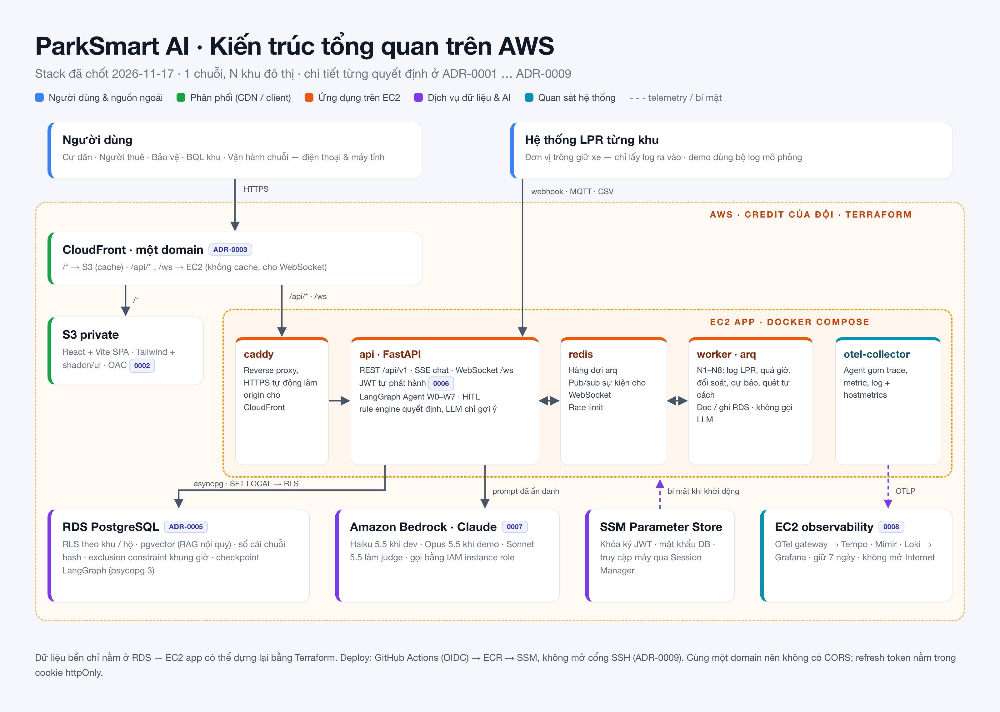
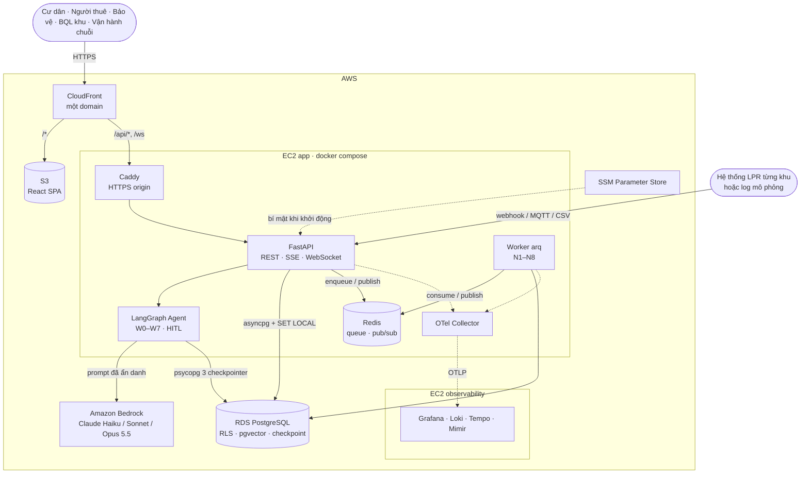
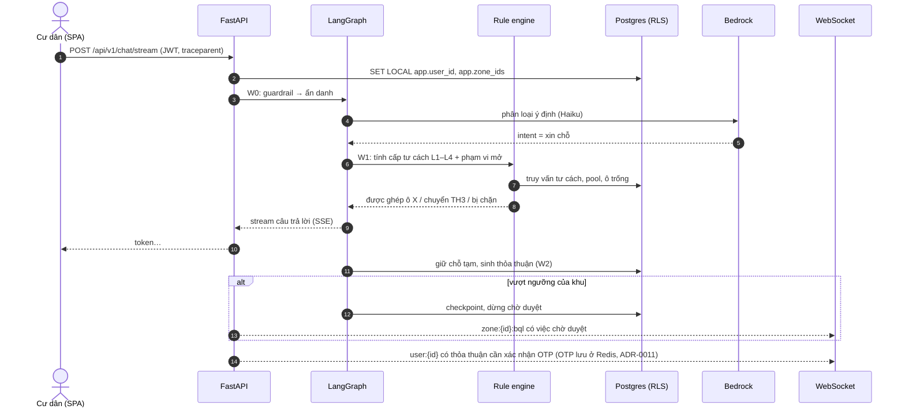

# Architecture Diagram — ParkSmart AI

> Stack và lý do lựa chọn: [docs/02-architecture/02-tech-stack.md](02-tech-stack.md) · ADR: [docs/07-adr/](../07-adr/)

Ảnh khác: [stack theo lớp](../images/ParkSmartAI-arch-tech-stack.png) · [giao tiếp REST / SSE / WebSocket, JWT, RLS](../images/ParkSmartAI-arch-communication.png) ·
[CI/CD](../images/ParkSmartAI-arch-cicd.png) · [observability](../images/ParkSmartAI-arch-observability.png) · [cây thư mục server](../images/ParkSmartAI-arch-backend-folders.png) (ADR-0010).

## Tổng quan hệ thống

## Luồng một yêu cầu đặt chỗ (W1 → W2)

## Thành phần

| Thành phần | Công nghệ | Vai trò |
|------------|-----------|---------|
| Client | React + Vite, Tailwind + shadcn/ui, TanStack Query | Chat, đặt chỗ, chia sẻ, dashboard BQL |
| CDN | CloudFront + S3 | Phục vụ client; định tuyến `/api/*` và `/ws` về EC2 |
| API | FastAPI | REST, SSE (chat), WebSocket (thông báo; 4 tuần đầu client polling danh sách `notification`), JWT |
| Agent | LangGraph + Claude trên Bedrock | W0–W7 (4 tuần: W0–W3, W7); LLM chỉ gợi ý, rule engine quyết định |
| Worker | arq + Redis | N1–N8; trong 4 tuần chỉ N1 nạp log LPR mô phỏng ([backlog](../01-product/backlog/03-background-workflows.md)) |
| DB | RDS PostgreSQL + pgvector | Dữ liệu nghiệp vụ, RLS theo khu / hộ, bằng chứng xác nhận (`consent_record`), nhật ký quyết định AI, RAG, checkpoint; 25 bảng ([ADR-0011](../07-adr/ADR-0011-mvp-simplifications.md)) |
| Observability | OpenTelemetry → LGTM | Liên kết metric → trace → log |
| Hạ tầng | Terraform, GitHub Actions, SSM | Dựng / xóa hạ tầng, deploy không cần SSH |
