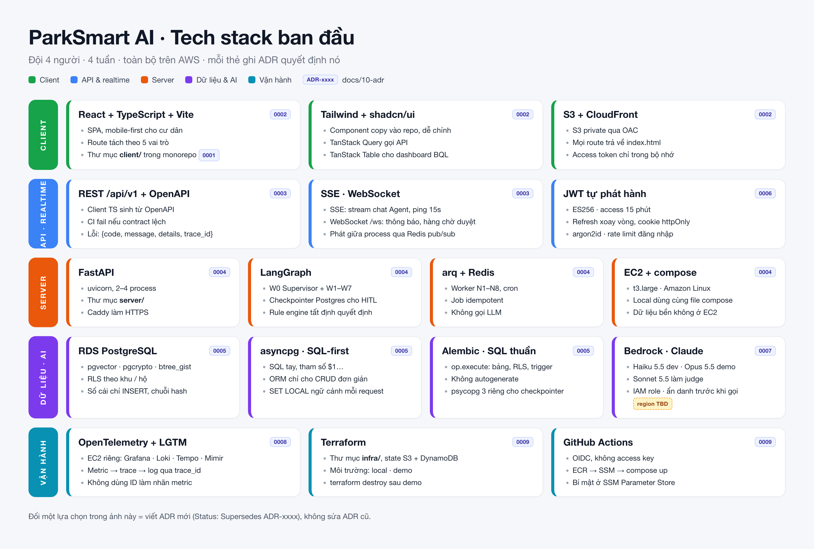

# Tech stack ban đầu — ParkSmart AI

> Chốt ngày 2026-11-17, qua phỏng vấn đội (4 người, 4 tuần). Mỗi quyết định có một ADR trong [docs/07-adr/](../07-adr/).
> Sơ đồ: [01-architecture-diagram.md](01-architecture-diagram.md) · Backlog: [docs/01-product/backlog/](../01-product/backlog/README.md)

**Các ảnh khác:**
- [Kiến trúc tổng quan trên AWS](../images/ParkSmartAI-arch-overview.png)
- [Client ↔ server giao tiếp thế nào](../images/ParkSmartAI-arch-communication.png)
- [CI/CD và hạ tầng](../images/ParkSmartAI-arch-cicd.png)
- [Quan sát hệ thống](../images/ParkSmartAI-arch-observability.png)
- [Cấu trúc thư mục server + ví dụ module sharing/](../images/ParkSmartAI-arch-backend-folders.png)

## Stack theo lớp

| Lớp | Lựa chọn | ADR |
|-----|----------|-----|
| Repo | Monorepo: `client/`, `server/`, `infra/`, `docs/` | [0001](../07-adr/ADR-0001-monorepo-client-server.md) |
| Client | React + TypeScript + Vite (SPA); Tailwind + shadcn/ui; TanStack Query; React Router | [0002](../07-adr/ADR-0002-react-vite-spa-on-s3-cloudfront.md) |
| Host client | S3 (private, OAC) + CloudFront | [0002](../07-adr/ADR-0002-react-vite-spa-on-s3-cloudfront.md) |
| API | REST `/api/v1` + OpenAPI; client TypeScript sinh từ OpenAPI | [0003](../07-adr/ADR-0003-rest-openapi-sse-websocket-single-domain.md) |
| Realtime | SSE cho chat Agent; WebSocket `/ws` cho thông báo, phát qua Redis pub/sub | [0003](../07-adr/ADR-0003-rest-openapi-sse-websocket-single-domain.md) |
| Domain | Một CloudFront: `/` → S3, `/api/*` và `/ws` → EC2 | [0003](../07-adr/ADR-0003-rest-openapi-sse-websocket-single-domain.md) |
| Server | FastAPI + uvicorn; LangGraph chạy trong process | [0004](../07-adr/ADR-0004-fastapi-langgraph-arq-on-ec2-docker-compose.md) |
| Worker | arq + Redis, hai queue: `bg` (N1–N8, không gọi LLM) và `agent` (W chạy nền, resume sau HITL) | [0004](../07-adr/ADR-0004-fastapi-langgraph-arq-on-ec2-docker-compose.md) |
| Cấu trúc server | Module Clean Architecture (M1–M14); `agent/` điều phối W0–W7; job N1–N8 là delivery adapter; import-linter; demo không có outbox, dùng port `publish()` ([ADR-0011](../07-adr/ADR-0011-mvp-simplifications.md)) | [0010](../07-adr/ADR-0010-backend-modules-agent-workflows-jobs.md) |
| Runtime | docker compose trên EC2 (caddy, api, worker, agent-worker, redis, otel-collector) | [0004](../07-adr/ADR-0004-fastapi-langgraph-arq-on-ec2-docker-compose.md) |
| DB | RDS PostgreSQL + pgvector, pgcrypto, btree_gist | [0005](../07-adr/ADR-0005-rds-postgres-asyncpg-rls-alembic-sql.md) |
| Truy cập dữ liệu | asyncpg + SQL viết tay (ORM chỉ cho CRUD đơn giản); RLS theo khu / hộ | [0005](../07-adr/ADR-0005-rds-postgres-asyncpg-rls-alembic-sql.md) |
| Migration | Alembic, nội dung viết bằng SQL thuần | [0005](../07-adr/ADR-0005-rds-postgres-asyncpg-rls-alembic-sql.md) |
| Checkpointer Agent | `langgraph-checkpoint-postgres` (psycopg 3, pool riêng) | [0005](../07-adr/ADR-0005-rds-postgres-asyncpg-rls-alembic-sql.md) |
| Auth | JWT tự phát hành (ES256, argon2id, demo: chỉ access JWT hạn 8 giờ, không refresh token, theo [ADR-0011](../07-adr/ADR-0011-mvp-simplifications.md)) | [0006](../07-adr/ADR-0006-self-issued-jwt-auth.md) |
| LLM | Claude qua Amazon Bedrock (`langchain-aws`): Haiku 5.5 khi dev, Opus 5.5 khi demo, Sonnet 5.5 làm judge | [0007](../07-adr/ADR-0007-claude-via-amazon-bedrock.md) |
| Quan sát hệ thống | OpenTelemetry → LGTM (Loki, Grafana, Tempo, Mimir) trên EC2 riêng | [0008](../07-adr/ADR-0008-opentelemetry-lgtm-on-dedicated-ec2.md) |
| Hạ tầng | Terraform (state S3 + DynamoDB) | [0009](../07-adr/ADR-0009-terraform-github-actions-ecr-ssm.md) |
| CI/CD | GitHub Actions (OIDC) → ECR → EC2 qua SSM; client → S3 + invalidate CloudFront | [0009](../07-adr/ADR-0009-terraform-github-actions-ecr-ssm.md) |
| Bí mật | SSM Parameter Store (SecureString) | [0009](../07-adr/ADR-0009-terraform-github-actions-ecr-ssm.md) |

## Môi trường

| Môi trường | Thành phần | Ghi chú |
|------------|-----------|---------|
| `local` | docker compose: api, worker, agent-worker, redis, postgres (pgvector), caddy; client chạy `vite dev` | LLM mặc định chạy mock; dùng Bedrock khi có AWS SSO profile |
| `demo` | CloudFront + S3; EC2 app; EC2 observability; RDS | Dựng bằng Terraform, xóa bằng `terraform destroy` sau demo |

## Rủi ro và việc cần xác nhận

| # | Nội dung | Ảnh hưởng | Xử lý |
|---|----------|-----------|-------|
| R1 | Haiku / Sonnet / Opus 5.5 có ở region đã chọn không, có cần cross-region inference không; quota | Không gọi được LLM, hoặc vướng tuân thủ dữ liệu | Kiểm tra trong tuần 1; xin tăng quota sớm (ADR-0007) |
| R2 | SSE / WebSocket qua CloudFront bị cắt khi chờ lâu | Chat bị ngắt giữa chừng | Gửi ping 15s; test sớm trên môi trường `demo` |
| R3 | Hai driver Postgres (asyncpg + psycopg 3) cùng dùng giới hạn kết nối của RDS | Hết kết nối | Đặt giới hạn pool cụ thể; theo dõi `db_client_connections_in_use` |
| R4 | Auth tự viết | Lỗ hổng bảo mật | Bộ test auth bắt buộc; review riêng (ADR-0006) |
| R5 | Một EC2 app là điểm hỏng duy nhất | Demo chết nếu máy chết | Có AMI / Terraform dựng lại nhanh; dữ liệu nằm ở RDS |
| R6 | ~~Code template còn ở gốc repo~~ **Đã xử lý (plan 007)** | — | Code ở `server/src/app/`; xem [01-server-structure.md](../04-development/01-server-structure.md) |
| R7 | LangGraph chạy lại toàn bộ node chứa `interrupt()` khi resume sau HITL | Giữ chỗ, ghi xác nhận (`consent_record`) hoặc thanh toán bị chạy hai lần | Node chờ duyệt không có tác dụng phụ; `idempotency_key = thread_id:step` có unique constraint ở từng bảng đích (ADR-0010, ADR-0011) |

## Gợi ý chia việc (4 người)

| Vai trò | Phụ trách |
|---------|-----------|
| **Server core** | Schema, RLS, migration, auth, rule engine, API REST, bằng chứng xác nhận |
| **AI Agent** | W0–W7, Bedrock, ẩn danh, checkpointer / HITL, RAG nội quy, eval |
| **Client** | SPA cho cư dân và BQL, client sinh từ OpenAPI, SSE; thông báo bằng polling trong 4 tuần (WebSocket sau) |
| **Hạ tầng và vận hành** | Terraform, CI/CD, LGTM, worker N1, N2 (N3–N8 sau 4 tuần), bộ log LPR mô phỏng |

Thứ tự triển khai tính năng theo [backlog](../01-product/backlog/README.md): làm hết **Ưu tiên 1** (hết tuần 2) trước, sau đó **Ưu tiên 2** (trước demo); **Ưu tiên 3** không làm trong 4 tuần. Việc từng người theo tuần: [Backlog §3](../01-product/backlog/README.md#3-lịch-4-tuần--4-vai-trò).
