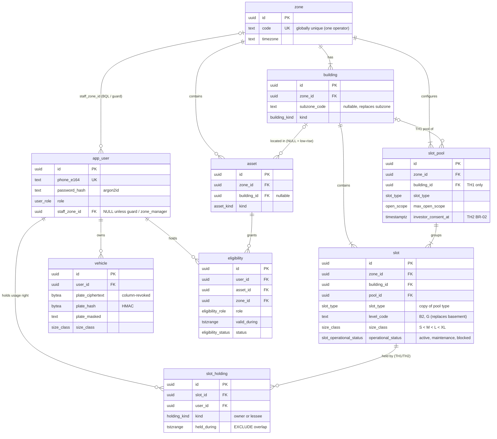
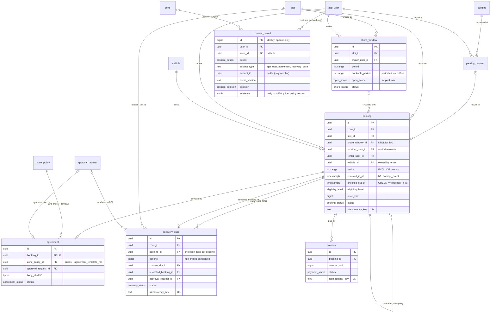
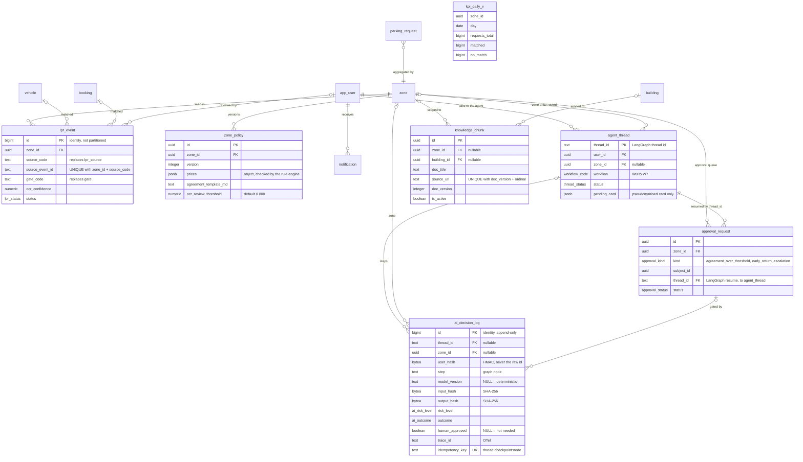

# 02 — Entity-relationship diagrams

Three diagrams, one per area, so each stays readable. They cover the **23 tables** of the v4 MVP schema ([ADR-0011](../10-adr/ADR-0011-mvp-simplifications.md)). Only keys and
the columns that explain a relationship are shown; the full column list is in
[03-data-dictionary](03-data-dictionary.md), and a column-level drawing of every table is in
[diagrams/schema-diagram.html](diagrams/schema-diagram.html). `zone_id` appears on almost every table: it is the RLS key, and composite
FKs `(x_id, zone_id)` keep it consistent with the parent (see
[01-data-model §4.3](01-data-model.md#43-zone-denormalised-everywhere-kept-honest-by-composite-fks)).

The 30 tables of v2 and the 8 tables of v3 that are not in the MVP (chain, subzone, basement, gate, voucher, disputes,
swaps, reporting tables, and in v4 `staff_zone`, `refresh_token`, `otp_challenge`, the ledger, `outbox`,
`idempotency_keys`, `audit_log`) are listed with their replacement in [08-deferred-tables](08-deferred-tables.md); they do
not appear below.

## 1. Facility, people and entitlements

**Relationships.**
* **Zone → Building → Slot** is the facility tree from PRD §2. The subzone and the basement level are plain columns
  (`building.subzone_code`, `slot.level_code`), and the size class is an ordered enum, so BR-11 is
  `vehicle.size_class <= slot.size_class`. All links are `ON DELETE RESTRICT`: facilities are retired with
  `is_active = false` (`slot.operational_status` for slots), never deleted, because bookings and the confirmation evidence point at them.
* **Slot pool** carries the open scope. A slot's type must equal its pool's type (composite FK
  `(pool_id, slot_type, zone_id)`), and the pool CHECK enforces the PRD §4 table (TH1 ≤ zone, TH2 ≤ chain with
  developer consent, TH3 = public).
* **Eligibility** is the M:N relationship between `app_user` and `asset`, carrying role and validity. An EXCLUDE
  constraint forbids two live entitlements for the same (user, asset, role) over overlapping time.
* **Slot holding** is the M:N-over-time relationship between `app_user` and `slot` (who may share a TH1/TH2
  slot). TH3 slots cannot have holders (CHECK on `slot_type`). A holding is closed (`voided_at`) and a new one opened,
  so the history stays.
* **Staff zone** is a nullable FK `app_user.staff_zone_id`: one zone per BQL member or guard (CHECK: only for
  `guard` / `zone_manager`), the source of the JWT claim `zone_ids` = `{staff_zone_id}`. It replaces the v3 junction
  `staff_zone` (ADR-0011).
* The only user-owned child that cascades on user delete is `notification`. Users are soft-deleted in practice, so
  the cascade only matters for test data.

## 2. Sharing, booking, agreement, consent evidence, recovery, money

**Relationships.**
* **share_window → booking**: a TH1/TH2 booking references the window through `(share_window_id, slot_id,
  provider_user_id)`, so the slot and the provider are guaranteed to be those of the window. A TH3 booking has
  no window and no provider (CHECK + trigger).
* **booking → booking** (`relocated_from_booking_id`): the TH3 replacement created when an owner returns early
  points at the booking it replaces.
* **booking 1–0..1 agreement** (UNIQUE `booking_id`): only shared TH1/TH2 bookings have an agreement; TH3 visits
  are zone-operated receipts (PRD §7).
* **agreement → zone_policy**: pins the exact rule version used. The price table (`zone_policy.prices`) and the
  agreement text (`zone_policy.agreement_template_md`) live in the policy row, so a later policy change does not
  alter a signed agreement.
* **consent_record** is deliberately *not* FK-linked to its subject (`subject_type`, `subject_id`). It is an
  immutable evidence log that must outlive and describe any row; a polymorphic reference is the standard trade-off
  here. Agreement confirmations carry `evidence.body_sha256` (hash nội dung thỏa thuận). The agreement OTP itself lives
  in Redis, so there is no OTP table. Append-only through the trigger `reject_mutation()`; natural key
  `UNIQUE (user_id, action, subject_id, terms_version, decision)`.
* **recovery_case → booking**: composite FKs `(booking_id, zone_id)`, `(relocated_booking_id, zone_id)`,
  `(chosen_slot_id, zone_id)` and `(approval_request_id, zone_id)` keep every linked row in the case's zone. A partial
  UNIQUE index `(booking_id) WHERE status NOT IN ('resolved','cancelled')` allows one open case per booking;
  CHECKs require `relocated_booking_id` when `resolved` and `approval_request_id` when `escalated`.

## 3. Operations: LPR, approvals, agent threads, AI audit, reporting

`kpi_daily_v` is a view over `parking_request` and `zone` (not a table): it replaces the v2
table `kpi_daily` and applies its own row filter by role and zone.

**Relationships.**
* **lpr_event** is a plain table (no partitioning in the MVP). Its dedupe key is
  `(zone_id, source_code, source_event_id)` (BR-13 / AC-10a). Gate and source are text codes, and the OCR review
  threshold is read from `zone_policy.ocr_review_threshold`. Plates are stored as ciphertext, hash and mask; the MVP
  shows the mask only.
* **approval_request.subject_id** is polymorphic by `kind` (agreement over the threshold, early-return escalation).
  The reverse FK `agreement.approval_request_id` gives referential integrity where it matters.
  `approval_request.thread_id` is an FK to `agent_thread(thread_id)`.
* **agent_thread** is one row per LangGraph thread. Its `pending_card` is pseudonymised and no raw message is stored
  (BR-14, D-12); the graph state itself lives in the checkpointer (schema `agent`).
* **ai_decision_log** is append-only and holds hashes and ids only. Its FKs (`thread_id`, `zone_id`,
  `approval_request_id`) are nullable and `RESTRICT`; `idempotency_key` is `thread_id:checkpoint_id:node`.
* **knowledge_chunk** carries its document fields (`doc_title`, `source_uri`, `doc_version`) itself; the v2 table
  `knowledge_doc` is gone. `zone_id` and `building_id` are real FKs.
* Removed with their tables: LPR sessions and overstay, plate-access log, disputes, swaps, vacancy forecast,
  occupancy, reconciliation, privacy requests, retention rules and workflow runs (the role of `workflow_run` is now `agent_thread`). See
  [08-deferred-tables](08-deferred-tables.md).

## 4. ON DELETE policy (summary)

| Policy | Where | Why |
|--------|-------|-----|
| `RESTRICT` (default for business FKs) | facility tree, users referenced by history, bookings, agreements, consent evidence, approvals, agent threads, AI decision log | Business history must never disappear through a cascade. Retire with `is_active` / soft delete. |
| `CASCADE` | user-private auxiliary (`notification`) | Children have no meaning without the parent. |
| `SET NULL` | `lpr_event.matched_vehicle_id/matched_booking_id`, `zone_policy.created_by` | Optional context links on logs; losing the link must not block deleting test data. |

`lpr_event.reviewed_by` stays `RESTRICT` because a CHECK requires it on reviewed rows (D-27).
