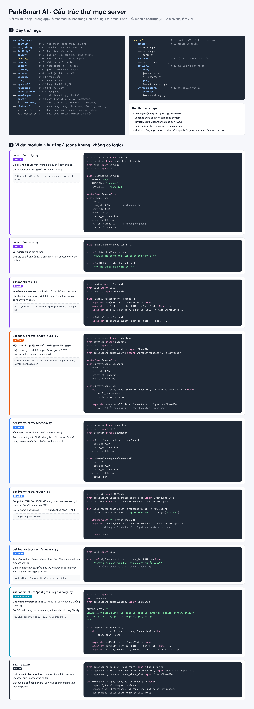

# Cấu trúc thư mục server

> Quyết định: [ADR-0001](../07-adr/ADR-0001-monorepo-client-server.md) (monorepo) · [ADR-0010](../07-adr/ADR-0010-backend-modules-agent-workflows-jobs.md) (module, workflow, job)
> Ảnh: [ParkSmartAI-arch-backend-folders.png](../images/ParkSmartAI-arch-backend-folders.png)



## 1. Gốc repo

```
server/         code backend
client/         React + Vite SPA — chưa khởi tạo
infra/          Terraform — chưa khởi tạo
eval/           eval harness + report (BTC chấm eval/results/report.md, nên để ở gốc)
docs/           tài liệu; docs/guide/ là guidebook của BTC
scripts/        hook ghi log AI của BTC (không sửa) + check_docs.py
Makefile        lệnh chạy từ gốc: make run / test / lint / eval
docker-compose.yml   api + postgres + redis; worker, agent-worker dùng --profile workers
```

## 2. `server/`

```
server/
├── src/app/
│   ├── identity/  eligibility/  facility/  policy/  sharing/  booking/  ledger/  payment/
│   ├── access/    dispute/      swap/      approval/ reporting/ notification/ knowledge/
│   ├── agent/            # M14 chat + workflow W0–W7
│   │   ├── domain/       # WorkflowRun, PseudonymMap, LLMPort
│   │   ├── usecase/      # chat_turn, start_workflow, resume_workflow
│   │   ├── workflows/    # mỗi workflow một thư mục: w1_request/{steps,graph,state}.py
│   │   ├── delivery/     # rest (SSE chat), jobs (run_workflow, resume_workflow)
│   │   └── infrastructure/   # guardrails.py (đã có), LangGraph runner, checkpointer
│   ├── platform/         # dùng chung, không chứa nghiệp vụ
│   │   ├── config/       # settings.py (đã có)
│   │   ├── llm/          # client.py — router classify/generate/judge (đã có)
│   │   ├── prompts/      # loader.py (đã có)
│   │   ├── db/  queue/  realtime/  (publish() port)  observability/
│   ├── main_api.py       # khởi động api, nối các module (đã có /api/v1/health)
│   └── main_worker.py    # cấu hình arq cho queue bg và agent
├── tests/                # unit/, integration/ — pytest, chạy bằng make test
├── prompts/              # system_prompt.md, safeguards.md, citation_rules.md
├── knowledge_base/       # tài liệu nguồn + chunk cho RAG W7, notebook prototype (docs/08-ai/02)
├── migrations/           # Alembic, nội dung SQL thuần (ADR-0005)
├── Dockerfile  requirements.txt  pytest.ini  ruff.toml
```

Thư mục chưa có code chỉ chứa `.gitkeep`.

## 3. Bên trong một module

Mọi module có cùng khung. Ví dụ `sharing/` (M4 Chia sẻ chỗ):

| Thư mục | Chứa gì | Được import |
|---------|---------|-------------|
| `domain/` | `entity.py` (dataclass), `errors.py` (lỗi nghiệp vụ), `ports.py` (interface repository, port tới module khác) | Chỉ thư viện chuẩn |
| `usecase/` | Mỗi file một thao tác, ví dụ `create_share_slot.py`: input DTO + class có `execute()` | `domain/` của chính module |
| `delivery/rest/` | `router.py` (endpoint), `schemas.py` (Pydantic request/response) | `usecase/`, `domain/errors` |
| `delivery/jobs/` | Job nền N, ví dụ `n4_forecast.py`. Chỉ có ở module sở hữu job: eligibility (N6), sharing (N4), access (N1, N2), booking (N9), dispute (N5), reporting (N3, N7, N8) | `usecase/` |
| `infrastructure/postgres/` | `repository.py`: SQL asyncpg, tham số `$1…` | `domain/` |

`main_api.py` / `main_worker.py` là nơi duy nhất tạo repository thật, đưa vào usecase rồi đưa usecase vào router hoặc job.

## 4. Quy tắc

1. Module không import module khác. Cần dữ liệu của module khác thì khai báo port trong `domain/ports.py`; composition root nối port đó vào usecase của module kia.
2. Chỉ `agent/` được gọi usecase của nhiều module. Chỉ `graph.py` và `agent/infrastructure/` được import langgraph.
3. Rule engine (`policy/domain`) quyết định; LLM chỉ gợi ý. Mọi lần gọi LLM đi qua `platform/llm`.
4. Job nền chỉ phát hiện và phát hiện sự việc; workflow Agent mới hành động. Demo không có outbox: usecase ghi `notification` cùng transaction, đẩy realtime sau commit qua port `platform.publish()` ([ADR-0011](../07-adr/ADR-0011-mvp-simplifications.md)). Job queue `bg` không import `platform.llm`.

## 5. Thêm mới ở đâu

| Việc | Đặt ở |
|------|-------|
| Endpoint REST mới | `<module>/delivery/rest/router.py` + một usecase trong `<module>/usecase/` |
| Bảng / truy vấn mới | Migration trong `server/migrations/`, SQL trong `<module>/infrastructure/postgres/` |
| Job nền N mới | `<module>/delivery/jobs/`, đăng ký trong `main_worker.BgWorkerSettings` |
| Workflow W mới | `agent/workflows/<wN_tên>/`, cửa vào ở `agent/usecase/start_workflow` |
| Prompt mới | `server/prompts/<tên>.md`, nạp bằng `load_prompt()` |
| Test | `server/tests/unit/<module>/` (mock port), `server/tests/integration/` (Postgres thật) |

## 6. Code template của BTC đã xử lý thế nào (plan 007)

| Template | Hiện tại |
|----------|----------|
| `src/config.py` | `platform/config/settings.py` |
| `src/services/llm.py` | `platform/llm/client.py` |
| `src/agents/prompts.py`, `prompts/*.md` | `platform/prompts/loader.py`, `server/prompts/` |
| `src/agents/guardrails.py` | `agent/infrastructure/guardrails.py` |
| `src/main.py` | `main_api.py` |
| `eval/run_eval.py`, `judge.py` | Giữ ở `eval/`, bỏ phụ thuộc graph demo; `run_agent()` chờ nối W0 |
| Graph ReAct, nodes, tools demo, personas, routes, schemas | Đã xoá: LLM tự chọn tool trái BR-14; lấy lại từ git history nếu cần tham khảo |
