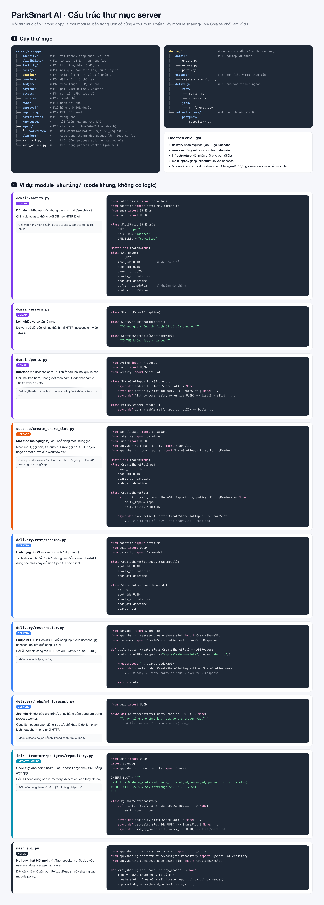

# ADR-0010: Cấu trúc server theo module, tầng điều phối `agent/` cho W0–W7 và job N1–N8 là delivery adapter

- **Status**: Accepted
- **Date**: 2026-11-17
- **Liên quan**: [Backlog](../01-product/backlog/README.md) · [ADR-0004](ADR-0004-fastapi-langgraph-arq-on-ec2-docker-compose.md) · [ADR-0005](ADR-0005-rds-postgres-asyncpg-rls-alembic-sql.md) · [ADR-0007](ADR-0007-claude-via-amazon-bedrock.md)



## Context

- **Backlog có ba nhóm việc:** 14 module nghiệp vụ (M1–M14), 8 workflow AI Agent (W0–W7) và 8 workflow nền (N1–N8).
- **Workflow cắt ngang nhiều module:**
  - W1 gọi tới M1, M2, M3 và M5.
  - W2 gọi tới M4, M6 và M7.
  - N2 phát hiện quá giờ, sau đó W4 gọi tới M9, M7 và M13.

  Nếu đặt workflow bên trong một module, module đó buộc phải import module khác. Clean Architecture của đội cấm import chéo như vậy.
- **Một workflow có nhiều cửa vào:**
  - Chat qua W0 Supervisor.
  - Nút trên app, ví dụ W3 "Tôi về sớm".
  - Sự kiện từ workflow nền, ví dụ N2 → W4 hoặc N1 → W5.
  - BQL duyệt rồi workflow chạy tiếp (HITL).
- **Quy tắc nghiệp vụ:** rule engine quyết định, LLM chỉ gợi ý (BR-14). Workflow nền chỉ phát hiện và chuẩn bị dữ liệu.
- **Template hiện có:** đã chia module theo `domain / usecase / delivery / infrastructure`, nhưng graph LangGraph đang nằm trong `chat/infrastructure`. Cách này không mở rộng được cho 8 workflow.

## Decision

**Ba tầng.** Mỗi loại việc nằm ở một tầng riêng:

| Loại | Đặt ở đâu | Được phép import |
|------|-----------|------------------|
| **Module (M)**: sở hữu dữ liệu và quy tắc nghiệp vụ | `app/<module>/{domain,usecase,delivery,infrastructure}` | Chỉ module của chính nó và `platform/` |
| **Workflow Agent (W)**: điều phối nhiều module, có LLM và HITL | `app/agent/` | `usecase` và DTO của mọi module, cùng `platform/` |
| **Workflow nền (N)**: phát hiện sự việc, không gọi LLM | `app/<module sở hữu dữ liệu>/delivery/jobs/` | Usecase của chính module đó |

**Cây thư mục** (`server/src/app/`, theo ADR-0001):

```
eligibility/ M1 tư cách (N6)   identity/ M1 tài khoản   facility/ M2
policy/      M3 rule engine    sharing/  M4 (N4)        booking/  M5
ledger/      M6                payment/  M7             access/   M8 lượt đỗ (N1, N2)
dispute/     M10 (N5)          swap/     M11            approval/ M12 hàng chờ HITL
reporting/   M12 (N3, N7, N8)  notification/ M13        knowledge/ RAG nội quy (W7)
agent/       M14 + W0–W7
  domain/         WorkflowRun, Intent, PseudonymMap, port LLMPort / WorkflowEngine
  usecase/        chat_turn · start_workflow · resume_workflow
  workflows/<wN>/ steps.py (không import langgraph) · graph.py · state.py
  delivery/       rest (SSE chat, POST /workflows/...) · jobs (run_workflow, resume_workflow)
  infrastructure/ langgraph runner, PostgresSaver, pseudonymizer, Bedrock client
platform/    db (transaction + SET LOCAL), outbox, queue (arq), realtime, llm, observability, config
main_api.py · main_worker.py   # 2 composition root
```

**Quy tắc phụ thuộc**
- **Module không import lẫn nhau.** Khi một module cần dữ liệu của module khác, nó khai báo port trong `domain/ports.py` của chính nó. Ví dụ `booking` khai báo `EligibilityChecker`, và composition root gắn port đó vào usecase của `eligibility`.
- **Bước trong workflow là hàm thuần.** Mỗi bước trong `workflows/<wN>/steps.py` có dạng `async (state, deps) -> partial_state`:
  - Bước `[TĐ]` gọi usecase của module.
  - Bước `[LLM]` gọi `LLMPort`.

  Chỉ `graph.py` và `agent/infrastructure` được import langgraph.
- **Rule engine (`policy/domain`) là hàm thuần, không có I/O.** LLM không bao giờ nhận quyền quyết định.
- **CI kiểm tra bằng `import-linter`:**
  - Module không import chéo.
  - `domain` không import thư viện ngoài.
  - Job `bg` không import `platform.llm`.

**Giao tiếp giữa các thành phần**

| Tình huống | Cơ chế |
|------------|--------|
| Gọi đồng bộ trong cùng một luồng (W1: tư cách → rule → ghép) | Bước workflow gọi usecase, chạy cùng process |
| Thay đổi trạng thái kéo theo việc khác (ghi sổ cái → thông báo) | **Outbox**: usecase ghi `outbox` trong cùng transaction. Relay đọc ra, enqueue job arq và publish Redis cho WebSocket |
| Workflow nền kích hoạt workflow Agent (N1 → W3/W5, N2 → W4, N5 → W6) | Job N chỉ phát sự kiện (ví dụ `OverstayDetected`) vào outbox. Handler enqueue `agent.run_workflow` trên queue `agent` (ADR-0004) |
| Kích hoạt từ app (W3) | REST `POST /api/v1/workflows/early-return` → usecase `StartWorkflow`. W0 chỉ là một trong các cửa vào |
| HITL (W2, W3, W5, W6) | Node `interrupt()` → `approval.Enqueue(zone_id, thread_id)` → BQL duyệt qua REST → enqueue `agent.resume_workflow`. Không resume ngay trong HTTP request |

**Idempotent**
- LangGraph **chạy lại toàn bộ node chứa `interrupt()`** khi resume. Vì vậy node chờ duyệt không được có tác dụng phụ.
- Mọi bước có ghi dữ liệu (giữ chỗ, ghi sổ cái, thanh toán, gửi thông báo) phải nhận `idempotency_key = thread_id:step`. DB có unique constraint trên key này (ADR-0005).

**Ẩn danh:** nằm trong wrapper `LLMPort` của `agent/infrastructure`, áp dụng cho mọi lần gọi LLM (ADR-0007). Module nghiệp vụ luôn làm việc với dữ liệu thật, đã có RLS bảo vệ.

## Consequences

**Tích cực**
- Mỗi workflow là một thư mục. Thêm W hoặc N không phải sửa module khác.
- Bước workflow test được bằng mock, không cần LangGraph. Rule engine test được không cần mock.
- Cùng một workflow chạy được từ chat, app, job hoặc sau khi BQL duyệt, nhờ đi qua usecase chung `StartWorkflow` / `ResumeWorkflow`.

**Tiêu cực**
- Thêm hạ tầng phải dựng: outbox, relay, bảng idempotency và import-linter.
- Composition root phải gắn nhiều port, nên `main_api.py` và `main_worker.py` dài.
- `agent/` phụ thuộc vào usecase của nhiều module. Đổi DTO của một module có thể làm vỡ workflow, nên cần test workflow trong CI.

## Observability Impact

- **Span:**
  - `agent.<wN>.<step>` cho mỗi bước, ví dụ `agent.w1.check_eligibility`.
  - `usecase.<Module>.<Op>` cho mỗi usecase.
  - `worker.<nN>.<job>` cho mỗi job nền.
  - Thuộc tính span: `workflow.id`, `workflow.thread_id`, `zone.id`.
- **`traceparent` đi kèm dữ liệu:** outbox row → payload job arq → metadata của lần chạy LangGraph. Nhờ vậy, chuỗi N2 → W4 → thông báo WebSocket nằm trong một trace liên tục.
- **Metric** (nhãn `workflow` chỉ nhận W0–W7, `outcome` là tập cố định):
  - `agent_workflow_runs_total{workflow,outcome}`
  - `agent_workflow_duration_seconds{workflow}` (có exemplar)
  - `agent_hitl_pending{workflow}` (gauge)
  - `outbox_lag_seconds` (gauge)
