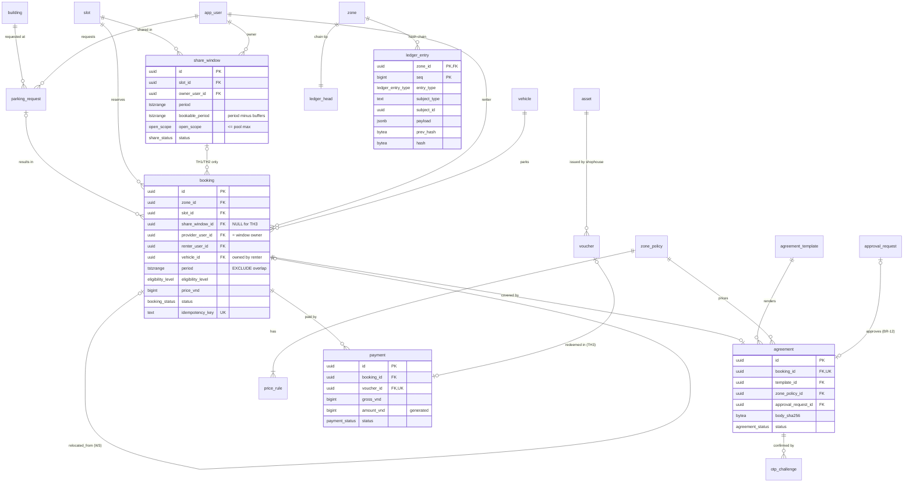
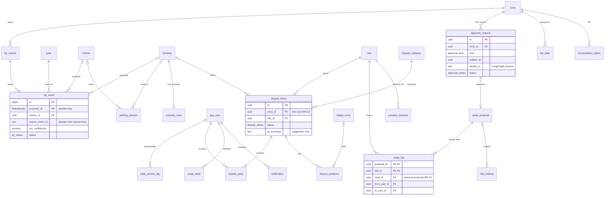

# 01 — Entity-relationship diagrams

Three diagrams, one per area, so each stays readable. Only keys and the columns that explain a relationship are
shown; the full column list is in [03-data-dictionary](03-data-dictionary.md). `zone_id` appears on almost every
table: it is the RLS key, and composite FKs `(x_id, zone_id)` keep it consistent with the parent (see
[00-overview §4.3](00-overview.md#43-zone-denormalised-everywhere-kept-honest-by-composite-fks)).

## 1. Organisation, people and entitlements

```mermaid
erDiagram
    chain ||--|{ zone : has
    zone ||--|{ subzone : has
    subzone ||--|{ building : contains
    building ||--|{ basement : has
    basement ||--|{ slot : contains
    zone ||--|{ slot_pool : configures
    building |o--o{ slot_pool : "TH1 pool of"
    slot_pool ||--|{ slot : groups
    size_class ||--o{ slot : sizes
    size_class ||--o{ vehicle : sizes
    zone ||--o{ gate : has
    chain ||--o{ holiday : calendar

    app_user ||--o{ vehicle : owns
    app_user ||--o{ eligibility : holds
    asset ||--o{ eligibility : "grants"
    zone ||--o{ asset : contains
    building |o--o{ asset : "located in (NULL = low-rise)"
    app_user ||--o{ slot_holding : "holds usage right"
    slot ||--o{ slot_holding : "held by (TH1/TH2)"
    app_user ||--o{ staff_zone : "works for"
    zone ||--o{ staff_zone : staffed
    app_user ||--o{ consent : gives
    app_user ||--o{ refresh_token : has

    zone {
        uuid id PK
        uuid chain_id FK
        text code
        text timezone
    }
    building {
        uuid id PK
        uuid zone_id FK
        uuid subzone_id FK
        building_kind kind
    }
    slot_pool {
        uuid id PK
        uuid zone_id FK
        uuid building_id FK "TH1 only"
        slot_type slot_type
        open_scope max_open_scope
        timestamptz investor_consent_at "TH2 BR-02"
    }
    slot {
        uuid id PK
        uuid zone_id FK
        uuid pool_id FK
        slot_type slot_type "copy of pool type"
        text size_class_code FK
    }
    app_user {
        uuid id PK
        text phone_e164 UK
        text password_hash "argon2id"
        user_role role
    }
    asset {
        uuid id PK
        uuid zone_id FK
        uuid building_id FK "nullable"
        asset_kind kind
    }
    eligibility {
        uuid id PK
        uuid user_id FK
        uuid asset_id FK
        uuid zone_id FK
        eligibility_role role
        tstzrange valid_during
        eligibility_status status
    }
    slot_holding {
        uuid id PK
        uuid slot_id FK
        uuid user_id FK
        holding_kind kind
        tstzrange held_during "EXCLUDE overlap"
    }
    vehicle {
        uuid id PK
        uuid user_id FK
        bytea plate_ciphertext "column-revoked"
        bytea plate_hash "HMAC"
        text plate_masked
    }
```

**Relationships.**
* **Chain → Zone → Subzone → Building → Basement → Slot** is the facility tree from PRD §2. All links are
  `ON DELETE RESTRICT`: facilities are retired with `is_active = false`, never deleted, because bookings and the
  ledger point at them.
* **Slot pool** carries the open scope. A slot's type must equal its pool's type (composite FK
  `(pool_id, slot_type, zone_id)`), and the pool CHECK enforces the PRD §4 table (TH1 ≤ zone, TH2 ≤ chain with
  developer consent, TH3 = public).
* **Eligibility** is the M:N relationship between `app_user` and `asset`, carrying role and validity. An EXCLUDE
  constraint forbids two live entitlements for the same (user, asset, role) over overlapping time.
* **Slot holding** is the M:N-over-time relationship between `app_user` and `slot` (who may share a TH1/TH2
  slot). TH3 slots cannot have holders (CHECK on `slot_type`). Swaps close one holding and open another, so the
  history stays.
* **Staff zone** is the M:N between staff users and zones (JWT `zone_ids`).
* User-owned children (`consent`, tokens) cascade on user delete. Users are soft-deleted in practice, so the
  cascade only matters for test data.

## 2. Sharing, booking, agreement, ledger, money

**Relationships.**
* **share_window → booking**: a TH1/TH2 booking references the window through `(share_window_id, slot_id,
  provider_user_id)`, so the slot and the provider are guaranteed to be those of the window. A TH3 booking has
  no window and no provider (CHECK + trigger).
* **booking → booking** (`relocated_from_booking_id`): the TH3 replacement created when an owner returns early
  points at the booking it replaces.
* **booking 1–0..1 agreement** (UNIQUE `booking_id`): only shared TH1/TH2 bookings have an agreement; TH3 visits
  are zone-operated receipts (PRD §7).
* **agreement → zone_policy / agreement_template**: pin the exact rule and template versions used, so a later
  policy change does not alter a signed agreement.
* **ledger_entry** is deliberately *not* FK-linked to its subject (`subject_type`, `subject_id`). It is an
  immutable log that must outlive and describe any row; a polymorphic reference is the standard trade-off here.
* **voucher 0..1–0..1 payment** (UNIQUE `payment.voucher_id`): a voucher is redeemed once, and only on a TH3 visit.

## 3. Operations: LPR, overstay, disputes, swaps, approvals, platform

Platform tables (`outbox`, `idempotency_keys`, `workflow_run`, `audit_log`, `knowledge_doc`, `knowledge_chunk`)
have no business FKs beyond `zone_id`/`user_id` and are omitted from the diagram.

**Relationships.**
* **lpr_event** is partitioned by month; its PK and dedupe key include `occurred_at` (a partitioned unique
  constraint must contain the partition key). `parking_session` stores event ids *without* FKs to avoid FK checks
  against a high-churn partitioned parent; N1 writes both in one transaction.
* **swap_leg** shares `zone_id` with its proposal *and* with its slot through two composite FKs, so a cross-zone
  swap (BR-10) cannot be stored at all.
* **dispute_party** and **swap_leg** are the junction tables for the M:N relationships ticket↔user and
  proposal↔slot/user.
* **approval_request.subject_id** is polymorphic by `kind` (agreement, dispute, swap, early-return escalation).
  The reverse FKs `agreement.approval_request_id` and `swap_proposal.approval_request_id` give referential
  integrity where it matters.

## 4. ON DELETE policy (summary)

| Policy | Where | Why |
|--------|-------|-----|
| `RESTRICT` (default for business FKs) | facility tree, users referenced by history, bookings, agreements, ledger, approvals | Business history must never disappear through a cascade. Retire with `is_active` / soft delete. |
| `CASCADE` | user-private auxiliaries (`consent`, `refresh_token`, `password_reset_token`, `otp_challenge`, `notification`, `staff_zone`); owned children (`price_rule` → policy, `dispute_party/evidence` → ticket, `swap_leg` → proposal, `knowledge_chunk` → doc, `vacancy_forecast` → slot, `holiday` → chain) | Children have no meaning without the parent. |
| `SET NULL` | `lpr_event.matched_vehicle_id/matched_booking_id/reviewed_by`, `zone_policy.created_by`, `workflow_run.initiator_user_id` | Optional context links on logs; losing the link must not block deleting test data. |
